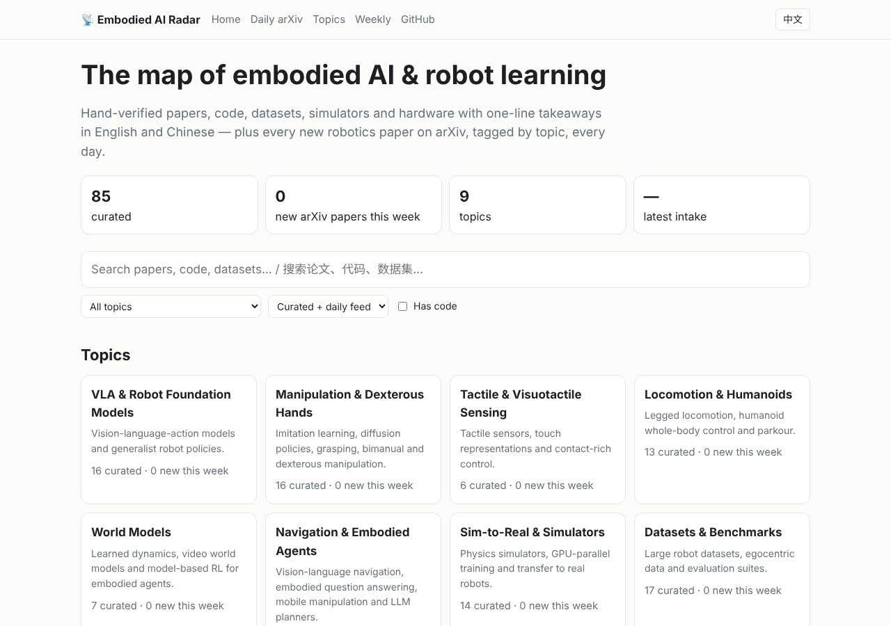

# Embodied AI Radar · 具身智能雷达

**A bilingual (English / [中文](README.zh-CN.md)), always-fresh map of embodied AI and robot learning.**
Hand-verified papers, code, datasets, simulators and hardware with one-line takeaways — plus every new robotics paper on arXiv, fetched and tagged by topic every day.

### 🌐 [Open the website → hu-zlatan.github.io/embodied-ai-radar](https://hu-zlatan.github.io/embodied-ai-radar/)

**CoRL 2026 (Nov 9–12, Austin):** the [program guide](https://hu-zlatan.github.io/embodied-ai-radar/venues/corl-2026-program.html) lists all 687 accepted papers by session and poster number, with filters and arXiv/code links, plus the 32 workshops.

**New to the field?** Follow the [reading path](https://hu-zlatan.github.io/embodied-ai-radar/start.html): 10 steps from RL and imitation basics through visuomotor policies, VLA models, simulation, locomotion and world models to hardware you can build — 41 hand-picked entries, each with a bilingual takeaway.

## Why this one

- **Verified.** Every curated arXiv ID is checked against arXiv and every link is checked by CI, weekly.
- **Fresh.** A GitHub Action pulls new cs.RO papers (plus robotics papers from cs.CV / cs.LG / cs.AI / cs.CL) every day and tags them by topic — they appear on the site without anyone touching the repo.
- **Searchable.** Instant search and filters (topic · robot type: arm, hand, humanoid, legged, drone… · accepted venue such as CoRL, NeurIPS, IROS · curated vs. daily · has code) on a fast static site that works on phones. Papers accepted at a venue also get a page per conference, e.g. [CoRL 2026](https://hu-zlatan.github.io/embodied-ai-radar/venues/corl-2026.html) ([all venues](https://hu-zlatan.github.io/embodied-ai-radar/venues/index.html)), and every robot type has its own page and Atom feed, e.g. [humanoid](https://hu-zlatan.github.io/embodied-ai-radar/robots/humanoid.html) · [dexterous hand](https://hu-zlatan.github.io/embodied-ai-radar/robots/hand.html) · [quadruped](https://hu-zlatan.github.io/embodied-ai-radar/robots/legged.html). You can also browse by lab or company, e.g. [NVIDIA](https://hu-zlatan.github.io/embodied-ai-radar/labs/nvidia.html) · [Stanford](https://hu-zlatan.github.io/embodied-ai-radar/labs/stanford.html) · [Shanghai AI Lab](https://hu-zlatan.github.io/embodied-ai-radar/labs/shanghai-ai-lab.html) ([all labs](https://hu-zlatan.github.io/embodied-ai-radar/labs/index.html)).
- **Signal, not just volume.** Each paper shows the GitHub stars of its code and, when it made [Hugging Face Daily Papers](https://huggingface.co/papers), its community upvotes (▲) — sort search by either, or see the most-upvoted robotics papers of the last two weeks on the home page.
- **Code tracker.** [Every curated repo](https://hu-zlatan.github.io/embodied-ai-radar/code.html) on one page: GitHub stars, stars gained this week, last update and detected license, with filters by topic and license.
- **Reusable.** The whole curated index is downloadable as [`curated.json`](https://hu-zlatan.github.io/embodied-ai-radar/curated.json) or [`curated.csv`](https://hu-zlatan.github.io/embodied-ai-radar/curated.csv) (opens in Excel; CC BY 4.0) with topics, robot types, links, takeaways and GitHub stars — build your own tools on it.
- **Bilingual.** Every curated entry has a one-line takeaway in English and Chinese; the site has an EN / 中文 toggle.
- **Citable.** Every arXiv paper on the site has a one-click BibTeX, and [`curated.bib`](https://hu-zlatan.github.io/embodied-ai-radar/curated.bib) bundles all curated papers (built from arXiv metadata). Every curated entry also has its own shareable page, e.g. [LEAP Hand](https://hu-zlatan.github.io/embodied-ai-radar/e/arxiv-2309.06440.html).

| What | How often |
|---|---|
| Daily arXiv feed ([site](https://hu-zlatan.github.io/embodied-ai-radar/feed.html) · [Atom](https://hu-zlatan.github.io/embodied-ai-radar/feed.xml); one Atom feed per topic, e.g. [VLA](https://hu-zlatan.github.io/embodied-ai-radar/topics/vla.xml)) | every day, automatically |
| Curated index (below and on the site) · agent picks from the daily feed ([Atom](https://hu-zlatan.github.io/embodied-ai-radar/picks.xml), a few a day, bilingual) | several times a week |
| [Weekly digest](digest/) | weekly |

## Topics

VLA & robot foundation models · manipulation & dexterous hands · tactile sensing · locomotion & humanoids · world models · navigation & embodied agents · perception, SLAM & 3D mapping · planning, control & safety · sim-to-real & simulators · datasets & benchmarks · hardware & open-source robots.

## Curated index

⭐ = highlight. Each topic shows highlights and the newest picks; **All N entries** opens the complete list. Generated from [`data/curated/`](data/curated) — edit the YAML, not these lists.

<!-- radar:start -->

[VLA & Robot Foundation Models](#vla) · [Manipulation & Dexterous Hands](#manipulation) · [Tactile & Visuotactile Sensing](#tactile) · [Locomotion & Humanoids](#locomotion) · [World Models](#world-models) · [Navigation & Embodied Agents](#navigation) · [Perception, SLAM & 3D Mapping](#perception) · [Planning, Control & Safety](#control) · [Robot Learning: RL & Imitation](#learning) · [Sim-to-Real & Simulators](#sim) · [Datasets & Benchmarks](#datasets) · [Hardware & Open-Source Robots](#hardware)

### VLA & Robot Foundation Models

_Vision-language-action models and generalist robot policies._ [Browse with the latest papers →](https://hu-zlatan.github.io/embodied-ai-radar/topics/vla.html)

- ⭐ **[A Pragmatic VLA Foundation Model](https://arxiv.org/abs/2601.18692)** (2026) — LingBot-VLA: an Apache-2.0 foundation model trained on about 20,000 hours of real data from nine dual-arm setups, tested on four platforms with 100 tasks each; code, base model and benchmark data are released. · [code](https://github.com/Robbyant/lingbot-vla) · [project](https://technology.robbyant.com/lingbot-vla)
- ⭐ **[From Pixels to Actions - Towards Native Vision-Language-Action Policies](https://arxiv.org/abs/2611.06918)** (2026) — NEO-VLA drops the visual encoder: images and language evolve in one backbone and a flow-matching action expert reads several depths. Layer probing shows action signals often peak before the final visual layer. · [code](https://github.com/EvolvingLMMs-Lab/NEO) · [project](https://weichenfan.github.io/NEO-VLA-Page/)
- ⭐ **[Open-HumanScale: An Open Recipe for Scaling Human and Robot Experience for Embodied Foundation Models](https://arxiv.org/abs/2611.06817)** (2026) — Opens a 50,000-hour annotated egocentric video corpus with pipelines and checkpoints. Reports a log-linear law between pretraining hours and robot success, and 84.6% on RoboTwin 2.0 Clean2Random. · [code](https://github.com/DAGroup-PKU/HumanNet) · [project](https://dagroup-pku.github.io/open-humanscale/)
- ⭐ **[RoboColosseum: Evaluating Physical Intelligence at Scale In-The-Wild](https://arxiv.org/abs/2611.02497)** (2026) — Blinded pairwise trials at 124 sites compare VLAs and frontier agents. Rankings barely agree across robots (W = 0.24), and open rankings poorly predict results after fine-tuning; no policy finishes a G1 task. · [code](https://github.com/RoboColosseum/robocolosseum-client)
- ⭐ **[π\*0.6: a VLA That Learns From Experience](https://arxiv.org/abs/2511.14759)** (2025) — RECAP trains a VLA with RL via advantage conditioning on demos, on-robot rollouts and teleop corrections; reports it more than doubles throughput on hard tasks like laundry folding and espresso making. · [project](https://pi.website/blog/pistar06)
- ⭐ **[π0: A Vision-Language-Action Flow Model for General Robot Control](https://arxiv.org/abs/2410.24164)** (2024) — A VLM backbone with a flow-matching action expert, trained across many robots, doing long dexterous tasks like laundry folding. · [code](https://github.com/Physical-Intelligence/openpi)
- ⭐ **[OpenVLA: An Open-Source Vision-Language-Action Model](https://arxiv.org/abs/2406.09246)** (2024) — A 7B open VLA built on Llama 2 + DINOv2/SigLIP; the de-facto open baseline for VLA research and LoRA fine-tuning. · [code](https://github.com/openvla/openvla)
- ⭐ **[RT-2: Vision-Language-Action Models Transfer Web Knowledge to Robotic Control](https://arxiv.org/abs/2307.15818)** (2023) — Coined "VLA" — co-fine-tuning a web-scale VLM to output action tokens transfers semantic knowledge to robot control. · [project](https://robotics-transformer2.github.io/)
- **[FineCraft: Enhancing VLA Models for Fine-Grained Manipulation](https://arxiv.org/abs/2611.03163)** (2026) — Fourth-place MetaFine Challenge entry: a task router picks between adapted DINOv2-DiT and π0.5 policies behind one interface, a practical recipe for adapting pretrained policies to precise tasks. · [code](https://github.com/eqcy/FineCraft)
- **[Ψ0: An Open Foundation Model Towards Universal Humanoid Loco-Manipulation](https://arxiv.org/abs/2603.12263)** (2026) — An open foundation model for humanoid loco-manipulation that argues against co-training on mixed human and humanoid data because of their kinematic differences.
- **[Asynchronous Robot Policies](https://arxiv.org/abs/2611.05155)** (2026) — Splits a large VLM that slowly updates a semantic memory from a light expert that acts at high rate, trained on staleness and delay; reports running the VLM at a tenth of its nominal rate with no significant loss. · [project](https://arp.insait.ai)
- **[Bayesian Active Learning for Intent Disambiguation in Interactive Robot Planning](https://arxiv.org/abs/2609.34270)** (2026) — Treats clarifying questions as Bayesian active learning over Signal Temporal Logic specs, so the robot asks fewer questions and hands a formal planner a verifiable task.

**[All 170 entries →](lists/vla.md)**

### Manipulation & Dexterous Hands

_Imitation learning, diffusion policies, grasping, bimanual and dexterous manipulation._ [Browse with the latest papers →](https://hu-zlatan.github.io/embodied-ai-radar/topics/manipulation.html)

- ⭐ **[AIRoA-0: Long-Horizon, Precise, Cross-Embodiment Manipulation from Handheld Data](https://arxiv.org/abs/2611.03815)** (2026) — Learned from 16,151 hours of handheld gripper demos with no robot data; reports 78% average success over ten tasks versus 27% for the best other VLA, and releases the dataset, weights and post-training recipe. · [project](https://a-0.airoa.io)
- ⭐ **[Generalizable Humanoid Manipulation with 3D Diffusion Policies](https://arxiv.org/abs/2410.10803)** (2024) — iDP3: whole-upper-body teleop, a 25-DoF humanoid with 3D LiDAR, and an improved 3D Diffusion Policy for noisy human data, aiming at skills beyond a single scene. · [code](https://github.com/YanjieZe/Improved-3D-Diffusion-Policy) · [project](https://humanoid-manipulation.github.io/)
- ⭐ **[Universal Manipulation Interface: In-The-Wild Robot Teaching Without In-The-Wild Robots](https://arxiv.org/abs/2402.10329)** (2024) — A handheld gripper with a GoPro collects demos anywhere; policies transfer directly to robot arms. · [code](https://github.com/real-stanford/universal_manipulation_interface)
- ⭐ **[Diffusion Policy: Visuomotor Policy Learning via Action Diffusion](https://arxiv.org/abs/2303.04137)** (2023) — Generating action sequences by denoising handles multimodal demos far better than regression; now a standard IL baseline. · [code](https://github.com/real-stanford/diffusion_policy)
- ⭐ **[Learning Fine-Grained Bimanual Manipulation with Low-Cost Hardware](https://arxiv.org/abs/2304.13705)** (2023) — ALOHA + ACT — a ~$20k bimanual teleop rig and an action-chunking Transformer that learns precise tasks from ~50 demos. · [code](https://github.com/tonyzhaozh/act)
- **[GRASP: Gradient-Guided Sampling for Contact-Rich Physics-Based Motion Retargeting](https://arxiv.org/abs/2611.05754)** (2026) — Retargets human demos under contact without a differentiable simulator: gradients come from archived sampling rollouts. Reports 92.8% success on 1,352 bimanual OakInk2 demos with no task-specific contact rewards. · [project](https://computationalrobotics.seas.harvard.edu/GRASP/)
- **[Spectrally Routed Diffusion Policy for Multi-Task Robotic Manipulation](https://arxiv.org/abs/2611.04477)** (2026) — SR-DP splits a trained diffusion denoiser by SVD into rank-one experts with task routing, so joint training stops hurting single tasks; reports beating per-task baselines on six RoboTwin tasks.
- **[A Tutorial on Shape Servoing of Deformable Objects-Part II: Advanced Concepts](https://arxiv.org/abs/2611.03825)** (2026) — Second part of a tutorial on data-driven, Jacobian-based shape control: which shape changes are reachable, how feature choice shapes behaviour, and the three ways the control loop fails. · [code](https://github.com/nachocz/tutorial_on_shape_servoing_of_deformable_objects) · [project](https://nachocz.github.io/tutorial_on_shape_servoing_of_deformable_objects/)
- **[Combining Constrained Sampling and Reinforcement Learning for Manipulation](https://arxiv.org/abs/2602.08557)** (2026) — Helps RL explore contact-rich tasks by resetting episodes with a contact-aware constrained state sampler, covering diverse contact modes; trains universal in-hand and whole-body policies. · [project](https://www.user.tu-berlin.de/mtoussai/26-CSRL/)
- **[DexHOT: Learning Hand-Object Configuration Transfer for Dexterous Manipulation](https://arxiv.org/abs/2611.05119)** (2026) — Sets dexterous goals as joint hand-object configurations and learns one transfer primitive from synthetic pairs, with no human motion; reports 69.4% on unseen objects in simulation and 61.5% over 200 real transfers. · [project](https://dex-hot.github.io/)
- **[Enabling Robust Cloth Manipulation via Inference-Time Simulator-in-the-Loop Refinement](https://arxiv.org/abs/2606.24552)** (2026) — Refines cloth actions online from one RGB image: a real-to-sim module estimates the cloth state, then simulator rollouts with prior-guided MPPI correct the policy's trajectory. · [project](https://silr-cloth.github.io/)
- **[FEIJOA: Task-Driven Grounding and Execution for Mobile Manipulation](https://arxiv.org/abs/2611.04080)** (2026) — A language-model agent resolves instructions against a posed RGB-D scan at test time instead of a prebuilt representation; 35 of 50 real Spot trials succeed, and most failures come from physical skills. · [project](https://williamshen-nz.github.io/feijoa/)

**[All 99 entries →](lists/manipulation.md)**

### Tactile & Visuotactile Sensing

_Tactile sensors, touch representations and contact-rich control._ [Browse with the latest papers →](https://hu-zlatan.github.io/embodied-ai-radar/topics/tactile.html)

- ⭐ **[DIGIT: A Novel Design for a Low-Cost Compact High-Resolution Tactile Sensor with Application to In-Hand Manipulation](https://arxiv.org/abs/2005.14679)** (2020) — An inexpensive, compact GelSight-style fingertip sensor that made vision-based touch widely accessible. · [code](https://github.com/facebookresearch/digit-interface)
- **[ReflexArc: Bottom-Up Integration of Instantaneous Tactile Reflexes into Whole-Body Humanoid Control](https://arxiv.org/abs/2611.04424)** (2026) — Adds a full-body tactile reflex that reaches the motors within 10 ms beneath a learned whole-body policy; on a G1 it cuts first force peak 34.1% versus the same reflex delayed by 20 ms. · [project](https://minusmodulo.github.io/reflexarc-website/)
- **[AnyTouch: Learning Unified Static-Dynamic Representation across Multiple Visuo-tactile Sensors](https://arxiv.org/abs/2502.12191)** (2025) — Learns one static-and-dynamic representation across different visuo-tactile sensors, and contributes TacQuad, an aligned multi-sensor tactile dataset. · [code](https://github.com/GeWu-Lab/AnyTouch)
- **[FACTR: Force-Attending Curriculum Training for Contact-Rich Policy Learning](https://arxiv.org/abs/2502.17432)** (2025) — Low-cost bilateral teleop relays arm forces to the operator, and a curriculum corrupts vision less and less over training so policies learn to attend to force.
- **[LocoTouch: Learning Dynamic Quadrupedal Transport with Tactile Sensing](https://arxiv.org/abs/2505.23175)** (2025) — A high-density tactile sensor across a quadruped's back lets it carry unsecured cylinders over long distances, a task that usually needs mounting hardware. · [code](https://github.com/linchangyi1/LocoTouch)
- **[PP-Tac: Paper Picking Using Tactile Feedback in Dexterous Robotic Hands](https://arxiv.org/abs/2504.16649)** (2025) — Picks up paper-like thin objects with a multi-fingered hand carrying high-resolution omnidirectional tactile sensors, tackling state estimation and grasp planning.
- **[Tactile Robotics: An Outlook](https://arxiv.org/abs/2508.11261)** (2025) — A broad outlook on tactile robotics, covering piezoresistive, piezoelectric, capacitive, magnetic and optical sensors and where the field is heading.
- **[ManiWAV: Learning Robot Manipulation from In-the-Wild Audio-Visual Data](https://arxiv.org/abs/2406.19464)** (2024) — An 'ear-in-hand' gripper records audio with vision during human demos in the wild; contact sound then helps policies when vision alone is ambiguous. · [code](https://github.com/real-stanford/maniwav)
- **[Octopi: Object Property Reasoning with Large Tactile-Language Models](https://arxiv.org/abs/2405.02794)** (2024) — Combines tactile perception with language so an embodied system can reason about physical properties learned by touch; contributes the PhysiCLeAR dataset. · [code](https://github.com/clear-nus/octopi)
- **[RoboPack: Learning Tactile-Informed Dynamics Models for Dense Packing](https://arxiv.org/abs/2407.01418)** (2024) — A recurrent graph network estimates object state and latent physics from visuo-tactile history; the learned dynamics model drives MPC for tasks like dense packing.
- **[Tactile-Augmented Radiance Fields](https://arxiv.org/abs/2405.04534)** (2024) — TaRF puts vision and touch in one 3D space: touch probes are registered to photos, and a conditional diffusion model estimates touch at unprobed positions. · [code](https://github.com/dou-yiming/TaRF)
- **[Evetac: An Event-based Optical Tactile Sensor for Robotic Manipulation](https://arxiv.org/abs/2312.01236)** (2023) — Replaces the RGB camera of an optical tactile sensor with an event camera; touch processing runs online at 1000 Hz and senses vibrations up to 498 Hz.

**[All 50 entries →](lists/tactile.md)**

### Locomotion & Humanoids

_Legged locomotion, humanoid whole-body control and parkour._ [Browse with the latest papers →](https://hu-zlatan.github.io/embodied-ai-radar/topics/locomotion.html)

- ⭐ **[Perceptive Humanoid Motion from Simulation](https://arxiv.org/abs/2611.06908)** (2026) — HALO trains humanoid skills on vision-language-motion data synthesised in a thousand procedural homes, so data scales with compute. Reports zero-shot transfer: 91% over 360 trials in six real environments. · [project](https://apple-aiml-research.github.io/ml-halo/)
- ⭐ **[BeyondMimic: From Motion Tracking to Versatile Humanoid Control via Guided Diffusion](https://arxiv.org/abs/2508.08241)** (2025) — One motion-tracking recipe with shared hyperparameters learns agile skills (cartwheels, flip-kicks); a guided latent diffusion model composes them for new goals like joystick control, zero-shot on hardware. · [code](https://github.com/HybridRobotics/whole_body_tracking)
- ⭐ **[SONIC: Supersizing Motion Tracking for Natural Humanoid Whole-Body Control](https://arxiv.org/abs/2511.07820)** (2025) — Tests scaling on humanoid control: more network, data and compute yield a generalist motion-tracking foundation model, with no manual reward engineering.
- ⭐ **[Real-World Humanoid Locomotion with Reinforcement Learning](https://arxiv.org/abs/2303.03381)** (2023) — A causal Transformer policy trained in simulation walks a full-size humanoid outdoors, zero-shot.
- ⭐ **[Learning to Walk in Minutes Using Massively Parallel Deep Reinforcement Learning](https://arxiv.org/abs/2109.11978)** (2021) — Thousands of parallel GPU environments train a quadruped walking policy in minutes; legged_gym became a standard starter. · [code](https://github.com/leggedrobotics/legged_gym)
- ⭐ **[DeepMimic: Example-Guided Deep Reinforcement Learning of Physics-Based Character Skills](https://arxiv.org/abs/1804.02717)** (2018) — Showed RL can imitate a wide range of motion clips, flips and spins included, while staying robust. The motion-imitation template much humanoid work builds on. · [code](https://github.com/xbpeng/DeepMimic)
- **[Ctrl-F: Force as an Interface for Humanoid Loco-Manipulation](https://arxiv.org/abs/2611.05507)** (2026) — Adds an explicit 3-D force command per contact body to motion tracking, set online by a planner. On hardware it pushes and kicks boxes up to 20 kg where a force-blind baseline fails, and adapts to added loads. · [project](https://forcectrl.github.io/)
- **[Coordinating Humanoid Loco-Manipulation through Action-Conditioned Latent Foresight](https://arxiv.org/abs/2611.04839)** (2026) — A latent world-action model scores proposed humanoid command sequences before running them and replans each step; reports 85.7% on seven real tasks against 70.0% for GR00T N1.7. · [project](https://ju6276.github.io/Action-Grounded-Foresight/)
- **[Deep Whole-body Parkour](https://arxiv.org/abs/2601.07701)** (2026) — Adds exteroceptive sensing to whole-body motion tracking, so a humanoid performs dynamic non-locomotion skills on uneven terrain. · [code](https://github.com/project-instinct/InstinctLab) · [project](https://project-instinct.github.io/deep-whole-body-parkour)
- **[HLO-AMP: Hierarchical Loco-Manipulation from Object-Aware Motion Priors](https://arxiv.org/abs/2611.05113)** (2026) — Trains the low-level humanoid controller by motion imitation with the object physically in the scene, then a high-level policy on top; on a Unitree G1 it carries varied boxes and recovers from drops.
- **[Hiking in the Wild: A Scalable Perceptive Parkour Framework for Humanoids](https://arxiv.org/abs/2601.07718)** (2026) — An end-to-end perceptive framework mapping depth to control for humanoid hiking over diverse unstructured terrain. · [project](https://project-instinct.github.io/hiking-in-the-wild)
- **[HumanX: Toward Agile and Generalizable Humanoid Interaction Skills from Human Videos](https://arxiv.org/abs/2602.02473)** (2026) — Compiles human video into generalizable real-world humanoid interaction skills, without task-specific design.

**[All 116 entries →](lists/locomotion.md)**

### World Models

_Learned dynamics, video world models, world action models (WAM) and model-based RL for embodied agents._ [Browse with the latest papers →](https://hu-zlatan.github.io/embodied-ai-radar/topics/world-models.html)

- ⭐ **[Cosmos 3: Omnimodal World Models for Physical AI](https://arxiv.org/abs/2606.02800)** (2026) — A family of omnimodal models that handles language, image, video, audio and action in one mixture-of-transformers, folding VLMs, video generators, world simulators and world-action models into a single framework. · [code](https://github.com/nvidia/cosmos) · [project](https://research.nvidia.com/labs/cosmos-lab/cosmos3/)
- ⭐ **[DreamDojo: A Generalist Robot World Model from Large-Scale Human Videos](https://arxiv.org/abs/2602.06949)** (2026) — A foundation world model pretrained on 44k hours of egocentric human video, using continuous latent actions as proxies for missing labels, then post-trained on small robot datasets. · [project](https://dreamdojo-world.github.io/)
- ⭐ **[OpenWAM: An Open, Modular Exploration Towards Systematic World-Action Model Pretraining](https://arxiv.org/abs/2609.07398)** (2026) — An open research stack that splits world-action models into composable modules, then runs controlled studies on what to inherit from video priors and how world and action learning interact. · [code](https://github.com/OpenWAM-Official/OpenWAM) · [project](https://openwam-official.github.io/)
- ⭐ **[RoboJEPA: Scaling Robotic Latent World Models](https://arxiv.org/abs/2610.10515)** (2026) — A JEPA world model trained across 12 robot embodiments; its imagination error follows a power law in compute, so model quality can be predicted beyond the fitted scale. · [code](https://github.com/facebookresearch/robo_jepa) · [project](https://robojepa.github.io/)
- ⭐ **[World Action Models: A Survey](https://arxiv.org/abs/2606.20781)** (2026) — Separates WAMs from world models, video generators and VLAs, then sorts work by what is generated (rendered, latent or none) and how it is built; concludes the field is moving toward generating less of the future. · [project](https://world-action-models.github.io/)
- ⭐ **[Mastering Diverse Domains through World Models](https://arxiv.org/abs/2301.04104)** (2023) — DreamerV3 — one set of hyperparameters works across 150+ tasks, including collecting diamonds in Minecraft from scratch. · [code](https://github.com/danijar/dreamerv3)
- **[Interactive World Simulation with Cosmos for Physical AI](https://arxiv.org/abs/2611.06627)** (2026) — Adapts Cosmos models for real-time interactive simulation: streams observations in response to actions, or renders them from an external simulator's state. Shown on manipulation, video transfer and multi-view AV. · [code](https://github.com/nvidia/cosmos) · [project](https://research.nvidia.com/labs/cosmos-lab/cosmos-simulation)
- **[ABot-PhysWorld: Interactive World Foundation Model for Robotic Manipulation with Physics Alignment](https://arxiv.org/abs/2603.23376)** (2026) — A 14B action-controllable video model trained on three million manipulation clips, with DPO-style post-training that suppresses unphysical results such as penetration, plus the EZSbench benchmark. · [code](https://github.com/amap-cvlab/ABot-PhysWorld)
- **[Being-H0.7: A Latent World-Action Model from Egocentric Videos](https://arxiv.org/abs/2605.00078)** (2026) — A latent world-action model that adds future-aware latent queries to a VLA-style policy and trains them with a future-informed branch, without generating future frames.
- **[Causal World Modeling for Robot Control](https://arxiv.org/abs/2601.21998)** (2026) — LingBot-VA: an autoregressive diffusion framework that learns frame prediction and policy together, with shared video-action latents, closed-loop rollout and asynchronous inference. · [code](https://github.com/Robbyant/lingbot-va) · [project](https://technology.robbyant.com/lingbot-va)
- **[Do World Action Models Generalize Better than VLAs? A Robustness Study](https://arxiv.org/abs/2603.22078)** (2026) — A robustness study that compares world action models against VLAs under perturbation, to test the claim that explicit future prediction gives better generalization. · [project](https://robot-robustness.github.io/RoboTwin2.0-Plus/)
- **[DreamX: Video Diffusion Model is a Universal Latent Action Learner](https://arxiv.org/abs/2611.05377)** (2026) — Reuses a pretrained video diffusion model to extract compact latent actions (1,200 to 4 tokens per frame) that act as a shared interface across humans, robots and environments, including zero-shot action transfer. · [code](https://github.com/cvlab-kaist/DreamX) · [project](https://cvlab-kaist.github.io/DreamX/)

**[All 89 entries →](lists/world-models.md)**

### Navigation & Embodied Agents

_Vision-language navigation, embodied question answering, mobile manipulation and LLM planners._ [Browse with the latest papers →](https://hu-zlatan.github.io/embodied-ai-radar/topics/navigation.html)

- ⭐ **[Do As I Can, Not As I Say: Grounding Language in Robotic Affordances](https://arxiv.org/abs/2204.01691)** (2022) — SayCan — an LLM proposes steps and learned value functions score what the robot can actually do right now.
- **[OdorSpaces: Visual-Olfactory Embodied Navigation in 3D Environments](https://arxiv.org/abs/2611.05738)** (2026) — Adds simulated odour transport to Habitat-Sim using Fire Dynamics Simulator, giving a smell-and-vision navigation benchmark for finding invisible gas leaks and early-stage fires, with a multimodal RL baseline.
- **[Aero-VPA: Few-Step Flow-Matching Control over Non-Reconstructive JEPA Latents for Agile Flight on Edge Hardware](https://arxiv.org/abs/2611.04392)** (2026) — A compact JEPA-plus-flow-matching quadrotor policy with an unusually candid report: cloning failed all 60 missions, DAgger plateaued, and a runtime shield raised simulated forest success from 21.1% to 52.2%. · [code](https://github.com/ylee-sling/Aero-VPA) · [project](https://huggingface.co/ylee-sling/aero-vpa)
- **[Collaborative Planning for UAV-UGV Teams under Operational Constraints via Masked Error-bounded Neuro-Symbolic Diffusion](https://arxiv.org/abs/2610.18850)** (2026) — MEND plans UAV-UGV recharge teamwork with masked diffusion, enforcing operational rules at execution through a logic-based action mask; tested on real maps and physical robot teams.
- **[Driving, Fast or Slow? Neuro-Symbolic Guidance for Motion Prediction in Multi-Modal Ground Mobility](https://arxiv.org/abs/2606.15251)** (2026) — TraCS adds interpretable, probabilistic traffic-rule logic to black-box motion predictors, generated from natural-language regulations; reports consistent gains on Argoverse 2. Oral.
- **[From Region Arrival to Instance-Level Grounding in Vision-and-Language Navigation](https://arxiv.org/abs/2607.03792)** (2026) — Argues VLN success metrics hide a 'last-3-meter grounding gap': agents stop nearby without facing the target. Adds instance-level metrics and REALM, a refinement module for any backbone.
- **[WayTrace: A Map-to-Language-to-Trace Hierarchy for Embodied Urban Navigation](https://arxiv.org/abs/2611.05129)** (2026) — A vision-language model turns web-map directions into one atomic command at a time, a predictor draws the path in the image, and RL tracks it; a wheeled-legged robot completes real missions of up to 1.37 km. · [project](https://way-trace.github.io)
- **[OpenFlyV2: An onboard vision-language-action model for aerial perception and navigation](https://arxiv.org/abs/2610.39287)** (2026) — A single onboard VLA for drones: one shared vision-language representation serves semantic understanding, spatial reasoning and closed-loop waypoint control. · [code](https://github.com/Ideal-ljl/AeroBrain) · [project](https://ideal-ljl.github.io/AeroBrain/)
- **[OSCAR: Obstacle Survival Curves for Adaptive Robot Navigation](https://arxiv.org/abs/2606.00990)** (2026) — CoRL 2026 Spotlight. Decides whether to wait or reroute at a blocked route by modeling how long each obstacle class tends to persist.
- **[SidewalkBench: Benchmarking Visual Navigation on Urban Sidewalks](https://arxiv.org/abs/2606.16953)** (2026) — CoRL 2026 Spotlight. Benchmark for visual navigation on urban sidewalks, built on Isaac Sim with procedurally generated and real-world environments. · [code](https://github.com/VAIL-UCLA/SidewalkBench) · [project](https://vail-ucla.github.io/SidewalkBench/)
- **[Benchmarking Obstacle-Conditioned Safety in Household Robot Navigation](https://arxiv.org/abs/2610.34674)** (2026) — OSMA-Bench: matched scenes that differ only in obstacle type test whether navigation policies slow down and keep clearance by how risky an obstacle is. VLM and VLA policies recognise the risk but rarely act on it. · [code](https://github.com/OSMA-Bench/OSMA-Bench) · [project](https://osma-bench.github.io/)
- **[Gaussian Episodic Memory for Long-Term Spatiotemporal Reasoning](https://arxiv.org/abs/2610.33158)** (2026) — GEMS keeps a 3D Gaussian Splatting map that is updated only where the scene changes, and an agent renders views on demand to answer when/where questions. Introduces GEMS-Bench (15 scenes, 473 QA pairs). · [project](https://abwerby.github.io/GEMS/)

**[All 46 entries →](lists/navigation.md)**

### Perception, SLAM & 3D Mapping

_Visual / LiDAR SLAM and odometry, 3D reconstruction, object pose, depth and open-vocabulary scene maps for robots._ [Browse with the latest papers →](https://hu-zlatan.github.io/embodied-ai-radar/topics/perception.html)

- ⭐ **[Segment Anything](https://arxiv.org/abs/2304.02643)** (2023) — SAM — a promptable segmentation model (points, boxes, masks) trained on 1B+ masks; a standard building block for object masks in robot perception pipelines. · [code](https://github.com/facebookresearch/segment-anything)
- ⭐ **[ORB-SLAM3: An Accurate Open-Source Library for Visual, Visual-Inertial and Multi-Map SLAM](https://arxiv.org/abs/2007.11898)** (2020) — The go-to feature-based SLAM library — monocular, stereo and RGB-D, with IMU fusion and multi-map relocalization. · [code](https://github.com/UZ-SLAMLab/ORB_SLAM3)
- **[CoReMatch: Recurrent Continuous Coordinate Refinement for Real-Time Robotic Feature Matching](https://arxiv.org/abs/2611.03932)** (2026) — Feature matcher that refines correspondences recurrently in continuous coordinates instead of on fixed grids; reports higher accuracy than Efficient LoFTR at over 10x its speed on embedded hardware.
- **[Articulated 3D Scene Graphs for Open-World Mobile Manipulation](https://arxiv.org/abs/2602.16356)** (2026) — MoMa-SG builds 3D scene graphs that encode how objects articulate, from RGB-D sequences, and adds the Arti4D-Semantic dataset; demonstrated on a quadruped and a mobile manipulator. · [project](https://momasg.cs.uni-freiburg.de)
- **[MosaicIMU: Composing Carrier Experts for Generalizable Neural Inertial Odometry](https://arxiv.org/abs/2606.09355)** (2026) — Neural inertial odometry across carriers: a router composes carrier-specific experts, and a light residual branch adapts to new ones. Reports 40% lower ATE than learned baselines.
- **[Kimera: an Open-Source Library for Real-Time Metric-Semantic Localization and Mapping](https://arxiv.org/abs/1910.02490)** (2019) — Open C++ library for real-time metric-semantic visual-inertial SLAM: VIO, robust pose graph, fast 3D mesher and dense semantic reconstruction as modular parts. · [code](https://github.com/MIT-SPARK/Kimera)
- **[AnchorHEC: Targetless Hand-Eye Calibration of Wrist and Fixed Cameras](https://arxiv.org/abs/2611.02884)** (2026) — Calibrates wrist and fixed cameras together with no target, from RGB, kinematics and a 3D foundation model; reports 86.4% lower translation and 71.6% lower rotation error in simulation than reconstruction baselines. · [project](https://hwanggb.github.io/AnchorHEC/)
- **[Anchor3R: Streaming 3D Reconstruction with Transient Anchors for Long-Horizon Visual Mapping](https://arxiv.org/abs/2606.05035)** (2026) — CoRL 2026 Spotlight. Current-centric streaming 3D reconstruction that predicts window-relative poses and local geometry in the current frame, to limit drift on long runs. · [code](https://github.com/polar-explorer/Anchor3R)
- **[OpenVIO: A Versatile Open-Source Visual-Inertial Odometry System](https://arxiv.org/abs/2610.41671)** (2026) — MIT-licensed visual-inertial odometry for research and products. Supports pinhole and fisheye cameras plus stitched 360° images, with benchmarks against other open-source VIO systems on public datasets. · [code](https://github.com/93won/openvio)
- **[ACE-Brain-0.6: Scaling Spatial Grounding for Physical Foundation Models](https://arxiv.org/abs/2610.27040)** (2026) — Fine-tunes Qwen3.5-9B on ~1.5M grounding samples auto-built from robot recordings plus other visual data; reports a 75.41 average over seven grounding benchmarks vs 73.68 for GPT-6 Astra. · [code](https://github.com/DAXIAORobotics/ACE-Brain-0.6) · [project](https://daxiaorobotics.github.io/ACE-Brain-0.6/)
- **[Which Depth Estimator for Jetson AGX Orin? A 2026 Benchmark of Monocular and Stereo Methods](https://arxiv.org/abs/2610.27199)** (2026) — Measured numbers for robot builders: nine monocular and stereo depth families (Depth Anything V2/3, Depth Pro, MoGe-2, Fast-FoundationStereo, ...) run on a Jetson AGX Orin, scored for metric accuracy and speed. · [code](https://github.com/nodarhub/orin-depth-benchmark)
- **[SpaRV: Sparse Radiance Voxels for Scalable Geometrically Consistent LiDAR-Visual Mapping and Rendering](https://arxiv.org/abs/2610.25665)** (2026) — A sparse-voxel radiance map built from LiDAR and camera data, aimed at robot logs — few viewpoints, imperfect poses and large scenes — while keeping geometry accurate and GPU memory in check. · [code](https://github.com/hku-mars/SpaRV)

**[All 36 entries →](lists/perception.md)**

### Planning, Control & Safety

_Motion planning, trajectory optimization, MPC, safety filters and safe learning-based control._ [Browse with the latest papers →](https://hu-zlatan.github.io/embodied-ai-radar/topics/control.html)

- ⭐ **[cuRobo: Parallelized Collision-Free Minimum-Jerk Robot Motion Generation](https://arxiv.org/abs/2310.17274)** (2023) — GPU-parallel motion generation for arms — many trajectory optimizations run at once, giving collision-free, smooth plans in milliseconds. · [code](https://github.com/NVlabs/curobo)
- **[PolicyIK: High-Precision Inverse Kinematics for Robot Arms with Reinforcement Learning](https://arxiv.org/abs/2611.05372)** (2026) — Learned goal-conditioned inverse kinematics that can hold the offset a position controller needs at rest; reports errors within 1 mm and 0.2° on 93.5% of held-out simulated tasks and training directly on a real arm. · [code](https://github.com/Tinaliu0123/PolicyIK)
- **[Scalable Deep Unfolding of Conic Optimizers](https://arxiv.org/abs/2606.13825)** (2026) — Makes deep unfolding work for large conic solvers via matrix-free implicit differentiation and a stable PSD-projection gradient; reports up to 50× speedups on SDP-based planning.
- **[cuRoboV2: Dynamics-Aware Motion Generation with Depth-Fused Distance Fields for High-DoF Robots](https://arxiv.org/abs/2603.05493)** (2026) — cuRoboV2 adds torque-aware B-spline trajectory optimization and GPU-native TSDF/ESDF perception for high-DoF robots. · [code](https://github.com/NVlabs/curobo)
- **[PyRoki: A Modular Toolkit for Robot Kinematic Optimization](https://arxiv.org/abs/2505.03728)** (2025) — PyRoki: a modular, cross-platform kinematic optimization toolkit that runs natively on CPU, GPU and TPU. · [project](https://pyroki-toolkit.github.io)
- **[RAM: Reachability Across Morphologies](https://arxiv.org/abs/2606.09108)** (2026) — CoRL 2026 Spotlight. A morphology-conditioned implicit neural model of pose reachability, differentiable, self-collision aware and able to generalize to unseen morphologies. · [code](https://github.com/TimWalter/ram) · [project](https://timwalter.github.io/ram)
- **[TAM: Torque Adaptation Module for Robust Motion Transfer in Manipulation](https://arxiv.org/abs/2606.06218)** (2026) — CoRL 2026 Spotlight. A module for contact-rich motion transfer across sim-to-real gaps, payloads and robot instances, as an alternative to domain randomization or system ID. · [code](https://github.com/Dongwon-Son/TAM) · [project](https://dongwon-son.github.io/tam-project-page/)
- **[A generalist policy for muscle-driven control across individual musculoskeletal models](https://arxiv.org/abs/2610.36535)** (2026) — MyoAcross trains one morphology-conditioned policy that tracks reference motions on unseen individual musculoskeletal models without fine-tuning. Reports 99.24% completion on 31 held-out models and 22.6% lower error. · [project](https://woodater-thu.github.io/MyoAcross/)
- **[Keeping Contact: Task-Adaptive Friction Margins for Bimanual Non-Prehensile Manipulation](https://arxiv.org/abs/2610.36961)** (2026) — Signed friction distance as a task-adaptive slip margin for bimanual tilting about a pivot; a sequence of SOCPs gives optimal contact forces. Real tests show adaptive margins beat fixed or no margins. · [project](https://keeping-contact.github.io/)
- **[CusADi2: Latency-Optimized Batch Computation of Robot Kinematics, Jacobians, and Hessians on the GPU](https://arxiv.org/abs/2610.25476)** (2026) — Evaluates batches of kinematics, Jacobians and Hessians on the GPU with low wall-clock latency, targeting online sampling- and gradient-based trajectory optimization. · [code](https://github.com/johnviljoen/cusadi2)
- **[PrismPlan: A Shared GPU Substrate for Motion Planning Across Paradigms](https://arxiv.org/abs/2610.23884)** (2026) — Builds batched GPU collision checking and forward kinematics once and runs sampling, search and optimization planners on top, so the three paradigms can be compared fairly. · [code](https://github.com/XiaoyubotMotionTeam/PrismPlan)
- **[Sub-Millisecond Reflexes for Continuous Physical Human-Robot Interaction](https://arxiv.org/abs/2610.21913)** (2026) — An open-source ROS 2 multimode controller that switches control modes and triggers safety reflexes in under a millisecond, without stopping the task; shown on a Franka arm. · [code](https://github.com/RoboRef/franka_reflex_engine)

**[All 32 entries →](lists/control.md)**

### Robot Learning: RL & Imitation

_Reinforcement learning, imitation learning and policy post-training methods for robots, on any embodiment._ [Browse with the latest papers →](https://hu-zlatan.github.io/embodied-ai-radar/topics/learning.html)

- ⭐ **[Precise and Dexterous Robotic Manipulation via Human-in-the-Loop Reinforcement Learning](https://arxiv.org/abs/2410.21845)** (2024) — HIL-SERL — real-world RL with human corrections, reported to reach near-perfect success on precise assembly and dynamic tasks after a few hours of training. · [code](https://github.com/rail-berkeley/hil-serl)
- ⭐ **[Proximal Policy Optimization Algorithms](https://arxiv.org/abs/1707.06347)** (2017) — The clipped policy-gradient method behind most GPU-parallel sim-to-real locomotion and dexterity training.
- **[ELA: End-to-End Latent Action Policy Learning from Video Demonstrations](https://arxiv.org/abs/2611.05571)** (2026) — Jointly trains a latent action model, latent policy and action decoder, so plentiful action-free video plus a few labelled robot demos can train a policy. Reports beating prior latent-action baselines. · [project](https://end2end-latent-action.github.io/)
- **[LLMs as MDP Designers: A Dependency-Aware Agentic Framework for Automated Robot Policy Generation](https://arxiv.org/abs/2611.04974)** (2026) — ARPG has an LLM design the RL pipeline before deployment: MDP first, then simulator code, with checks that state, action and reward agree; reports more successful policies than monolithic LLM baselines in Isaac Sim.
- **[RACE: Calibrated Cumulative Scoring for Rollout-Free Robot Policy Checkpoint Selection](https://arxiv.org/abs/2611.05838)** (2026) — Ranks checkpoints without rollouts: action deviations are calibrated against state-dependent thresholds from held-out demos, then combined in a running product. Reports rankings that align with real deployment. · [project](https://changyeon.site/race)
- **[Control-Ready Uncertainty for Trajectory Diffusion](https://arxiv.org/abs/2610.12431)** (2026) — SCOPE gives diffusion trajectory models calibrated uncertainty tubes without Monte Carlo sampling, by distilling score curvature; tested in crowd navigation and Franka manipulation. · [project](https://zackaxue.github.io/SCOPE-project-page/)
- **[FedGuide: Diffusion Prior Alignment and Value Baseline Guidance for Heterogeneous Federated Reinforcement Learning](https://arxiv.org/abs/2609.18964)** (2026) — Federated RL for heterogeneous clients that aggregates diffusion behavior priors with optimal transport rather than averaging policies, plus a low-variance DICE value baseline.
- **[GSBR: Geometric Support Behavior Regularization for Online RL](https://arxiv.org/abs/2611.05295)** (2026) — Online RL on top of a pretrained policy, penalised by distance from that policy's support: free inside it, smoothly costly outside; reports average success rising from 33% to 95% across 19 benchmark tasks. · [project](https://charlesxu0124.github.io/gsbr/)
- **[SCoCaT: Success Conditioned Constrained Reinforcement Learning for Spacecraft Docking](https://arxiv.org/abs/2609.06061)** (2026) — Shows termination-based constrained RL can learn to avoid the goal when constraints tighten near it, and fixes this with a dense success critic; validated on spacecraft docking tasks.
- **[TARC: Time-Adaptive Robotic Control](https://arxiv.org/abs/2510.23176)** (2026) — A policy predicts each action and how long to hold it. Reports matching high-frequency control at under half the rate on an RC car and Unitree Go1, plus simulated VLA inference. · [project](https://arnavsukhija.github.io/projects/tarc)
- **[Towards Embodiment Scaling Laws in Robot Locomotion](https://arxiv.org/abs/2505.05753)** (2025) — Tests 'embodiment scaling laws' on about 1,000 generated robots: does training on more bodies improve generalization to unseen ones? · [project](https://embodiment-scaling-laws.github.io/)
- **[Behavior Graphs: Unsupervised Graph Structures for Interpreting Robot Deployment Data](https://arxiv.org/abs/2611.00405)** (2026) — Compresses policy rollouts into one directed graph of behavior modes linked to outcomes, to guide what data to collect next. In a user study on three real tasks, 16 of 18 participants preferred it to rollout videos. · [project](https://try.behavior-graphs.com/)

**[All 60 entries →](lists/learning.md)**

### Sim-to-Real & Simulators

_Physics simulators, GPU-parallel training and transfer to real robots._ [Browse with the latest papers →](https://hu-zlatan.github.io/embodied-ai-radar/topics/sim.html)

- ⭐ **[When the Simulator Fails, Not the Policy: Auditing Contact Artifacts in Simulated Robot Benchmarks](https://arxiv.org/abs/2610.41857)** (2026) — Many benchmark 'policy failures' are physics-engine ejections. SimuGuard traced RoboTwin artifacts to one collision constant; changing it cut artifact episodes from 12/100 to none and lifted five tasks 89% → 98%. · [code](https://github.com/ALEXander22568/simuguard)
- ⭐ **[MuJoCo](https://mujoco.org/)** (2012) — Fast, accurate contact physics; the default simulator for robot learning research, open-sourced by DeepMind. · [code](https://github.com/google-deepmind/mujoco)
- **[Genie Sim 3.0 : A High-Fidelity Comprehensive Simulation Platform for Humanoid Robot](https://arxiv.org/abs/2601.02078)** (2026) — Genie Sim 3.0: a manipulation simulation platform whose LLM tool builds scenes from natural language, with an LLM- and VLM-based automated benchmark. · [code](https://github.com/AgibotTech/genie_sim)
- **[Learning Physics-Guided Residual Dynamics for Deformable Object Simulation](https://arxiv.org/abs/2607.13451)** (2026) — PGRD simulates deformables with an optimizable spring-mass backbone plus learned residuals, reporting better accuracy than either alone; used for MPC and action-conditioned video prediction. · [project](https://pgrd-robot.github.io/)
- **[GaussGym: An open-source real-to-sim framework for learning locomotion from pixels](https://arxiv.org/abs/2510.15352)** (2025) — Drops 3D Gaussian Splatting into vectorized physics simulators as a renderer, reporting over 100,000 steps per second on consumer GPUs for learning from pixels.
- **[Taccel: Scaling Up Vision-based Tactile Robotics via High-performance GPU Simulation](https://arxiv.org/abs/2504.12908)** (2025) — GPU tactile simulation combining IPC and ABD; the authors report running 18 times faster than real time across thousands of parallel environments.
- **[BiGym: A Demo-Driven Mobile Bi-Manual Manipulation Benchmark](https://arxiv.org/abs/2407.07788)** (2024) — Benchmark of 40 home tasks for mobile bimanual robots, from reaching to kitchen cleaning, each with human-collected demonstrations. · [project](https://chernyadev.github.io/bigym/)
- **[DIFFTACTILE: A Physics-based Differentiable Tactile Simulator for Contact-rich Robotic Manipulation](https://arxiv.org/abs/2403.08716)** (2024) — Differentiable tactile simulator with an FEM soft-body elastomer model, built for contact with many material types rather than mostly rigid objects. · [code](https://github.com/Genesis-Embodied-AI/DiffTactile)
- **[GRUtopia: Dream General Robots in a City at Scale](https://arxiv.org/abs/2407.10943)** (2024) — Simulated interactive 3D society for many robot types; its GRScenes set has 100k annotated scenes across 89 categories that combine into city-scale worlds. · [code](https://github.com/OpenRobotLab/GRUtopia)
- **[ManiSkill-HAB: A Benchmark for Low-Level Manipulation in Home Rearrangement Tasks](https://arxiv.org/abs/2412.13211)** (2024) — GPU-accelerated Home Assistant Benchmark with realistic low-level control; the authors report over 3x the speed of prior magical-grasp versions. · [code](https://github.com/arth-shukla/mshab)
- **[TacEx: GelSight Tactile Simulation in Isaac Sim -- Combining Soft-Body and Visuotactile Simulators](https://arxiv.org/abs/2411.04776)** (2024) — Brings GIPC soft-body contact and the Taxim and FOTS tactile simulators into Isaac Sim for GelSight Mini, with Isaac Lab RL environments.
- **[AuRA: From Atoms to Bits through Autonomous Robot Interaction](https://arxiv.org/abs/2610.34452)** (2026) — Automates the robot interaction and data preparation behind physics-informed digital twins; reports 88.5% less active human labor per asset across 13 deformable objects. · [code](https://github.com/Yoonkyo/AuRA) · [project](https://aura-robot.github.io/)

**[All 48 entries →](lists/sim.md)**

### Datasets & Benchmarks

_Large robot datasets, egocentric data and evaluation suites._ [Browse with the latest papers →](https://hu-zlatan.github.io/embodied-ai-radar/topics/datasets.html)

- ⭐ **[LeRobot](https://github.com/huggingface/lerobot)** (2024) — PyTorch library with datasets, pretrained policies (ACT, Diffusion, SmolVLA) and drivers for low-cost arms.
- ⭐ **[LIBERO: Benchmarking Knowledge Transfer for Lifelong Robot Learning](https://arxiv.org/abs/2306.03310)** (2023) — 130 language-conditioned tasks in four suites; now the most common simulation benchmark for VLA papers. · [code](https://github.com/Lifelong-Robot-Learning/LIBERO)
- ⭐ **[Open X-Embodiment: Robotic Learning Datasets and RT-X Models](https://arxiv.org/abs/2310.08864)** (2023) — 1M+ trajectories from 22 robot types pooled by 30+ labs; RT-X models trained on it beat single-robot baselines. · [code](https://github.com/google-deepmind/open_x_embodiment)
- **[BEAKER: An Expert-Curated Benchmark for Embodied Brains in Self-Driving Chemical Laboratories](https://arxiv.org/abs/2611.06911)** (2026) — 1,000 expert-curated questions over 11 image and video task types test multimodal LLMs as the brain of a self-driving chemistry lab: affordances, trajectories, apparatus setup, safety and step reasoning.
- **[MESA: An Evaluation Framework for Compositional, Semantic, and Spatial Generalization in Robotics](https://arxiv.org/abs/2611.05567)** (2026) — Suites isolate generalisation across spatial layout, object instance, object category and subtask composition, plus bimanual BiMESA. The best of seven baselines reaches only 52% and 49%. · [project](https://pairlab.github.io/MESA)
- **[CRONOS: Benchmarking Non-Episodic Reinforcement Learning for Robotic Manipulation](https://arxiv.org/abs/2611.05080)** (2026) — A simulation benchmark for RL fine-tuning of VLAs without frequent resets; finds naive fine-tuning fails from object and end-effector shifts, and that targeted reset allocation and bias fixes mitigate it. · [project](https://embodiedai-ntu.github.io/cronos/)
- **[EgoVerse: An Egocentric Human Dataset for Robot Learning from Around the World](https://arxiv.org/abs/2604.07607)** (2026) — A shared platform and dataset for human-data robot learning: 1,362 hours and 80k episodes across 1,965 tasks and 2,087 demonstrators, with contributions from labs and industry.
- **[PyRUA-DataFarm: LLM Agent as a Cost-Efficient Teleoperator for Real-Ready Robot Data](https://arxiv.org/abs/2611.05320)** (2026) — A coding agent rebuilds a task in simulation from one calibration episode, then a video model renders photographic data; reports 93 vs. 84 of 100 real successes against teleop data, at about $107 per hour of data. · [code](https://github.com/DAGroup-PKU/PyRUA-Lean) · [project](https://dagroup-pku.github.io/PyRUA-Lean/DataFarm)
- **[RoboScope Kit: Unified Interfaces for Fast and Scalable Embodied-AI Evaluation](https://arxiv.org/abs/2611.03850)** (2026) — Wraps each model once and each benchmark once, then schedules simulator workers and policy replicas as separate pools; reports evaluation 4.45x to 6.16x faster than the official StarVLA evaluator on one GPU. · [code](https://github.com/MINT-SJTU/RoboScope-Kit) · [project](https://roboscope.pages.dev/)
- **[RoboWM-Bench: A Benchmark for Evaluating World Models in Robotic Manipulation](https://arxiv.org/abs/2604.19092)** (2026) — Evaluates video world models by whether generated manipulation can be converted into actions and executed in physics simulation, not only whether it looks realistic.
- **[TWIST2: Scalable, Portable, and Holistic Humanoid Data Collection System](https://arxiv.org/abs/2511.02832)** (2025) — Portable, mocap-free humanoid teleoperation and data collection built around a VR headset, aimed at making whole-body demonstrations scale. · [code](https://github.com/amazon-far/TWIST2) · [project](https://twist-data.github.io)
- **[ClothDojo: Learned Data Generation and Benchmarking for Bimanual Garment Flattening and Folding](https://arxiv.org/abs/2611.01190)** (2026) — Sim platform where a fine-tuned VLA generates nearly 8,000 successful garment trajectories, re-rendered for RGB policies. Those beat policies trained on the original human data, but unseen garments stay hard. · [project](https://clothdojo.github.io/)

**[All 72 entries →](lists/datasets.md)**

### Hardware & Open-Source Robots

_Low-cost arms, hands, grippers and data-collection rigs you can build._ [Browse with the latest papers →](https://hu-zlatan.github.io/embodied-ai-radar/topics/hardware.html)

- ⭐ **[Pixel: A Co-Designed Full-Stack Robot System for Learning General-Purpose Mobile Manipulation](https://arxiv.org/abs/2611.03648)** (2026) — Hardware, data and learning designed together: a low-cost wheeled humanoid with compliant grippers, teleoperation and robot-free human data collection, one whole-body controller and a shared policy pipeline. · [project](https://pixel-robot.com/pixel)
- ⭐ **[LEAP Hand: Low-Cost, Efficient, and Anthropomorphic Hand for Robot Learning](https://arxiv.org/abs/2309.06440)** (2023) — A 16-DoF dexterous hand buildable for about $2,000 from off-the-shelf parts. · [code](https://github.com/leap-hand/LEAP_Hand_API) · [project](https://leaphand.com/)
- **[MABEL: An Open Anthropomorphic Mobile Bimanual Platform for Teleoperation and Learning](https://arxiv.org/abs/2611.04083)** (2026) — An open-source 56-DOF mobile bimanual robot with 7-DOF arms and 17-DOF hands for about US$8.1k in parts, with Apple Vision Pro teleoperation and a demonstrated imitation learning pipeline. · [project](https://robotmabel.github.io/website/)
- **[RAIPAL: A Powerful and Agile Humanoid Arm for Human Tasks](https://arxiv.org/abs/2611.04334)** (2026) — A humanoid arm whose force, speed and endurance targets come from human upper-limb measurements; reports a 20 kg peak payload (2.25x its own mass) and 20.6 m/s endpoint speed.
- **[Shape Your Body: Value Gradients for Multi-Embodiment Robot Design](https://arxiv.org/abs/2606.00702)** (2026) — Reuses a frozen multi-robot value function as a differentiable surrogate for robot design, avoiding a new co-design RL loop per robot; handles over 1100 design parameters.
- **[MEVITA: Open-Source Bipedal Robot Assembled from E-Commerce Components via Sheet Metal Welding](https://arxiv.org/abs/2508.17684)** (2025) — Open-source biped built from e-commerce parts by sheet-metal welding, avoiding the size and fragility limits of 3D-printed designs. · [project](https://haraduka.github.io/mevita-hardware)
- **[The Duke Humanoid: Design and Control For Energy Efficient Bipedal Locomotion Using Passive Dynamics](https://arxiv.org/abs/2409.19795)** (2024) — Open-source 10-DoF humanoid for locomotion research; an RL policy using passive dynamics cuts cost of transport by up to 50% in sim and 31% on hardware. · [code](https://github.com/generalroboticslab/dukeHumanoidHardwareControl)
- **[KlaskTron: An Open-Source Platform for Physical Adversarial Multi-Agent RL](https://arxiv.org/abs/2611.03138)** (2026) — A desktop testbed under $2,500 for adversarial multi-agent RL, built around the tabletop game KLASK: open CAD and BOM, an Isaac Lab digital twin, and a sim-to-real baseline with a learned actuator model. · [code](https://github.com/IDSCETHZurich/klask_rl) · [project](https://idscethzurich.github.io/klask_hardware)
- **[SwapBot: Tool-Centric Robot Manipulation via Interchangeable End-Effectors and Tactile Sensing](https://arxiv.org/abs/2610.40646)** (2026) — Instead of one universal gripper: a fixed robot-side coupling plus cheap tool-side adapters with tactile sensors turn household tools into swappable end effectors; imitation policies cook tofu and flip meat. · [project](https://personalrobotics.github.io/SwapBot)
- **[UMI-Live for In-The-Wild Bimanual Robotics Data Collection](https://arxiv.org/abs/2610.39385)** (2026) — Open-source bimanual UMI with camera, LiDAR-inertial sensing, compute and power on board: no external tracking or calibration; parallel SLAM outputs training-ready data. Releases 40 h of data and hardware files. · [code](https://github.com/AfterQuery-Research/umi-live) · [project](https://umi-live.github.io/)
- **[EgoThumb: A Vision-Driven Supernumerary Robotic Thumb for Autonomous Grasp and Holding Assistance](https://arxiv.org/abs/2610.37582)** (2026) — Open-source wearable extra thumb: a tendon-driven finger with motors moved to the forearm; an imitation policy maps palm-camera images to joint positions, inferring intent without explicit triggers. · [code](https://github.com/JayeFu/ego_thumb_firmware) · [project](https://ego-thumb.github.io)
- **[OpenJaws: An Open Hardware UMI Framework with Stereo Localization for Generalist Manipulation](https://arxiv.org/abs/2610.36598)** (2026) — Fully open UMI-style handheld gripper with a low-cost stereo camera for metric, low-drift trajectories, plus UMI-Loc-Bench-v1 for localization accuracy; hardware, software and data under a permissive license. · [project](https://open-jaws.github.io/)

**[All 41 entries →](lists/hardware.md)**

<!-- radar:end -->

## Related lists & learning resources

Other good maps of the field, plus courses and docs we point newcomers to. This radar complements them with search, a daily feed and bilingual takeaways.

<!-- resources:start -->

**Related lists**

- [Embodied-AI-Guide](https://github.com/TianxingChen/Embodied-AI-Guide) `中文` — A large Chinese-language beginner's guide to embodied AI, from fundamentals to research directions.
- [Embodied_AI_Paper_List (HCPLab-SYSU)](https://github.com/HCPLab-SYSU/Embodied_AI_Paper_List) — Paper list accompanying a survey of embodied AI, organized by perception, interaction, agents and sim-to-real.
- [awesome-humanoid-robot-learning](https://github.com/YanjieZe/awesome-humanoid-robot-learning) — A focused list of humanoid robot learning papers.
- [Awesome-Robotics-Foundation-Models](https://github.com/robotics-survey/Awesome-Robotics-Foundation-Models) — Papers on foundation models in robotics, from the survey "Foundation Models in Robotics".
- [awesome-embodied-vla-va-vln](https://github.com/jonyzhang2023/awesome-embodied-vla-va-vln) — A frequently updated list of vision-language-action (VLA) and vision-language navigation (VLN) papers.

**Courses & textbooks**

- [Robotic Manipulation (MIT 6.4210, Russ Tedrake)](https://manipulation.csail.mit.edu/) — Free online textbook and course on perception, planning and control for manipulation, with Drake notebooks.
- [Underactuated Robotics (MIT, Russ Tedrake)](https://underactuated.mit.edu/) — Free online textbook on nonlinear dynamics, optimal control and trajectory optimization for walking, flying and swimming robots.
- [CS 285 Deep Reinforcement Learning (UC Berkeley)](https://rail.eecs.berkeley.edu/deeprlcourse/) — Sergey Levine's deep RL course; lecture videos and slides are public.
- [蘑菇书 EasyRL (Datawhale)](https://github.com/datawhalechina/easy-rl) `中文` — A popular open Chinese reinforcement-learning tutorial (from Q-learning to PPO, DDPG and TD3) with code; readable online.
- [动手学强化学习 (Hands-on RL)](https://github.com/boyu-ai/Hands-on-RL) `中文` — Chinese RL textbook built from runnable Jupyter notebooks; the online version is at hrl.boyuai.com.

**Tool docs**

- [LeRobot documentation](https://huggingface.co/docs/lerobot) — Hands-on docs for Hugging Face LeRobot — record data, train ACT/diffusion/VLA policies and run them on low-cost arms.
- [Isaac Lab documentation](https://isaac-sim.github.io/IsaacLab/) — Docs and tutorials for NVIDIA's GPU-parallel robot learning framework.
- [MuJoCo documentation](https://mujoco.readthedocs.io/) — Reference and modeling guide for the MuJoCo physics engine (MJX, MJCF, Python bindings).

**Communities**

- [古月居 (GuYueHome)](https://www.guyuehome.com/) `中文` — A long-running Chinese ROS and robotics community with tutorials and forums.

<!-- resources:end -->

## Contribute

Found a great paper, repo, dataset or robot that's missing — or a mistake? [Open an issue](https://github.com/hu-zlatan/embodied-ai-radar/issues/new) or send a pull request that adds one entry to `data/curated/<topic>.yaml`. See [CONTRIBUTING.md](CONTRIBUTING.md).

## How this project is run

This repository is **built and maintained by an AI agent** (Claude, made by Anthropic) that works on a schedule, under the oversight of [@hu-zlatan](https://github.com/hu-zlatan). The agent's brief is [AUTOPILOT.md](AUTOPILOT.md); its notes, decisions and run log are in [`.autopilot/`](.autopilot). Data is never invented: entries that fail verification are fixed or removed.

## License

Code: [MIT](LICENSE). Curated text and data: [CC BY 4.0](LICENSE-DATA.md). arXiv metadata: CC0, from the [arXiv API](https://info.arxiv.org/help/api/index.html) — thank you to arXiv for use of its open access interoperability.
