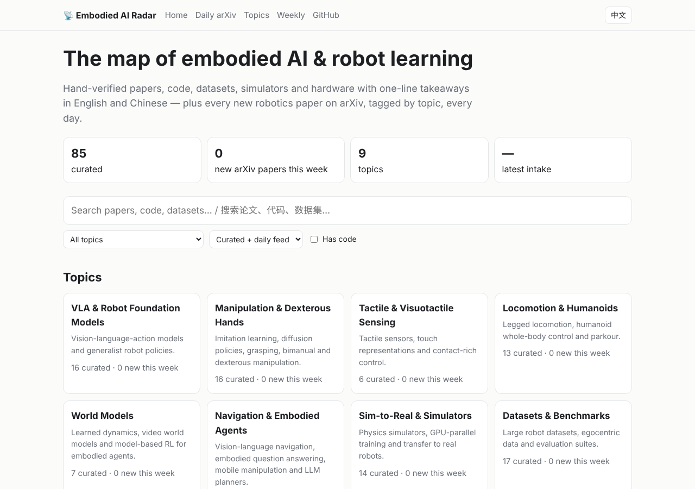

# 具身智能雷达 · Embodied AI Radar

**中英双语（[English](README.md) / 中文）、持续更新的具身智能与机器人学习全景图。**
人工核验的论文、代码、数据集、仿真器与硬件，配一句话要点；外加每天自动抓取并按主题标注的 arXiv 机器人新论文。

### 🌐 [打开网站 → hu-zlatan.github.io/embodied-ai-radar](https://hu-zlatan.github.io/embodied-ai-radar/?lang=zh)

## 特点

- **可信**：每个精选条目的 arXiv 编号都会与 arXiv 核对，所有链接每周由 CI 自动检查。
- **新鲜**：GitHub Action 每天抓取 cs.RO 新论文（以及 cs.CV / cs.LG / cs.AI / cs.CL 中的机器人相关论文）并按主题标注，自动出现在网站上。
- **好找**：快速静态网站，支持即时搜索与筛选（主题 · 机器人形态：机械臂、灵巧手、人形、足式、无人机… · 精选/每日 · 是否有代码），手机友好。
- **双语**：每个精选条目都有中英文一句话要点，网站支持 EN / 中文 切换。
- **好引用**：网站上每篇 arXiv 论文都可一键复制 BibTeX，[`curated.bib`](https://hu-zlatan.github.io/embodied-ai-radar/curated.bib) 打包了全部精选论文（由 arXiv 元数据生成）。

| 内容 | 更新频率 |
|---|---|
| 每日 arXiv 论文（[网站](https://hu-zlatan.github.io/embodied-ai-radar/feed.html?lang=zh) · [Atom 订阅](https://hu-zlatan.github.io/embodied-ai-radar/feed.xml)；每个主题也有单独的 Atom 订阅，如 [VLA](https://hu-zlatan.github.io/embodied-ai-radar/topics/vla.xml)） | 每天自动 |
| 精选索引（见下方与网站） | 每周多次 |
| [每周精选](digest/) | 每周 |

## 精选索引

⭐ = 重点推荐。由 [`data/curated/`](data/curated) 自动生成——请修改 YAML，而不是这个列表。

<!-- radar:start -->

[VLA 与机器人基础模型](#vla) · [操作与灵巧手](#manipulation) · [触觉与视触觉感知](#tactile) · [运动控制与人形机器人](#locomotion) · [世界模型](#world-models) · [导航与具身智能体](#navigation) · [感知、SLAM 与三维建图](#perception) · [规划、控制与安全](#control) · [机器人学习：强化学习与模仿学习](#learning) · [仿真与 Sim-to-Real](#sim) · [数据集与基准](#datasets) · [硬件与开源机器人](#hardware)

### VLA 与机器人基础模型

_视觉-语言-动作模型与通用机器人策略。_ [在网站上查看与最新论文 →](https://hu-zlatan.github.io/embodied-ai-radar/topics/vla.html)

- ⭐ **[π0: A Vision-Language-Action Flow Model for General Robot Control](https://arxiv.org/abs/2410.24164)** (2024) — VLM 主干加流匹配动作专家，跨多种机器人训练，能完成叠衣服等长时程灵巧任务。 · [代码](https://github.com/Physical-Intelligence/openpi)
- ⭐ **[OpenVLA: An Open-Source Vision-Language-Action Model](https://arxiv.org/abs/2406.09246)** (2024) — 基于 Llama 2 与 DINOv2/SigLIP 的 7B 开源 VLA，是 VLA 研究与 LoRA 微调的事实开源基线。 · [代码](https://github.com/openvla/openvla)
- ⭐ **[RT-2: Vision-Language-Action Models Transfer Web Knowledge to Robotic Control](https://arxiv.org/abs/2307.15818)** (2023) — 提出 "VLA" 概念：把网络规模的视觉语言模型联合微调为输出动作 token，把语义知识迁移到机器人控制。 · [项目页](https://robotics-transformer2.github.io/)
- **[CondenseVLA: Learnable History Condensation for Efficient Multi-Frame VLA](https://arxiv.org/abs/2610.25927)** (2026) — 不靠简单加长历史帧窗口，而是学习把过去的帧压缩成少量 token，保留短暂接触、遮挡等转瞬即逝的线索。 · [代码](https://github.com/FeiyangHong/CondenseVLA)
- **[FastVLA: Task-Conditioned and Temporally Adaptive Visual Token Compression for Efficient Vision-Language-Action Models](https://arxiv.org/abs/2610.22146)** (2026) — 只保留当前任务所需的视觉 token、并让 token 预算随时间步变化，以加快 VLA 推理。 · [代码](https://github.com/jiuyixu25/FastVLA)
- **[LTM: Latent Transition Based In-Context Memory for Vision-Language-Action Models](https://arxiv.org/abs/2610.21362)** (2026) — 通过缓存相邻观测之间的紧凑潜在转移，为 π0.5 加入记忆，面向关键物体移出视野的任务。 · [代码](https://github.com/buaa-colalab/LTM-pi)
- **[MambaAct: Efficient Mamba Action Experts for Flow-Matching Vision-Language-Action Models](https://arxiv.org/abs/2610.22951)** (2026) — 保留 π0.5 预训练的视觉语言编码器，把在去噪循环中被反复调用的 Transformer 动作专家换成紧凑的 Mamba 专家，以降低推理开销。 · [代码](https://github.com/giakhuyendihoc/MambaAct)
- **[NestedVLA: Learning to Consolidate and Generate Skills for Vision-Language-Action Models](https://arxiv.org/abs/2610.23271)** (2026) — 先独立学习各项技能，再用嵌套超网络“生成”VLA 参数来事后整合技能，而不是直接合并权重。 · [代码](https://github.com/WanyuGroup/NeurIPS2026-NestedVLA)
- **[REKI: Registering Knowledge in VLAs](https://arxiv.org/abs/2610.22178)** (2026) — 仅用公开数据预训练的 2.4B VLM + 流匹配 VLA；报告称只输给约两倍大的模型，并用少量寄存器 token 实现低成本记忆。 · [代码](https://github.com/kyutai-labs/reki)
- **[VLA-$Δ$: Learning Physical State Transition for Vision-Language-Action Models](https://arxiv.org/abs/2610.21306)** (2026) — 认为 VLA 容易过拟合“观测→动作”的对应关系，因此显式监督动作应引起的物理状态变化，而不是在语言或像素空间里预测未来状态。 · [代码](https://github.com/ZJU-OmniAI/VLA-Delta)
- **[π0.5: a Vision-Language-Action Model with Open-World Generalization](https://arxiv.org/abs/2504.16054)** (2025) — 通过异构数据联合训练，让移动操作机器人在从未见过的家庭中整理厨房和卧室。 · [代码](https://github.com/Physical-Intelligence/openpi)
- **[FAST: Efficient Action Tokenization for Vision-Language-Action Models](https://arxiv.org/abs/2501.09747)** (2025) — 用基于 DCT 的分词器压缩动作块，使自回归 VLA 能学习高频灵巧控制。
- **[Fine-Tuning Vision-Language-Action Models: Optimizing Speed and Success](https://arxiv.org/abs/2502.19645)** (2025) — OpenVLA-OFT：并行解码、动作分块与连续动作让 VLA 微调更快、成功率更高。 · [代码](https://github.com/moojink/openvla-oft)
- **[GR-3 Technical Report](https://arxiv.org/abs/2507.15493)** (2025) — 字节跳动 Seed 的通用 VLA——机器人数据模仿学习并与网络视觉-语言数据联合训练，再用 VR 采集的人类轨迹快速适配；在 ByteMini 双臂移动机器人上展示长时程与衣物操作任务。
- **[GR00T N1: An Open Foundation Model for Generalist Humanoid Robots](https://arxiv.org/abs/2503.14734)** (2025) — 双系统（VLM 慢思考 + 扩散快执行）人形机器人策略，用真实、人类视频与合成数据训练。 · [代码](https://github.com/NVIDIA/Isaac-GR00T)
- **[Gemini Robotics: Bringing AI into the Physical World](https://arxiv.org/abs/2503.20020)** (2025) — 基于 Gemini 2.0 的 VLA 与具身推理模型，面向灵巧、通用的机器人控制。
- **[Hi Robot: Open-Ended Instruction Following with Hierarchical Vision-Language-Action Models](https://arxiv.org/abs/2502.19417)** (2025) — 高层 VLM 理解开放式指令与执行中的纠正，并将其转化为简短语言指令交给底层 π0 策略执行。
- **[RoboBrain 2.0 Technical Report](https://arxiv.org/abs/2507.02029)** (2025) — 开源具身视觉语言模型（7B 与 32B），面向空间定位、可供性、轨迹预测与多步任务规划，作为底层策略之上的“大脑”。 · [代码](https://github.com/FlagOpen/RoboBrain2.0)
- **[SmolVLA: A Vision-Language-Action Model for Affordable and Efficient Robotics](https://arxiv.org/abs/2506.01844)** (2025) — 约 4.5 亿参数的 VLA，用社区 LeRobot 数据训练，可在消费级 GPU 上运行。 · [代码](https://github.com/huggingface/lerobot)
- **[CogACT: A Foundational Vision-Language-Action Model for Synergizing Cognition and Action in Robotic Manipulation](https://arxiv.org/abs/2411.19650)** (2024) — 不再让 VLM 直接输出动作 token，而是用独立的扩散动作 Transformer 以 VLM 的“认知”特征为条件生成动作；报告在仿真和真机上明显优于 OpenVLA。 · [代码](https://github.com/microsoft/CogACT)
- **[Octo: An Open-Source Generalist Robot Policy](https://arxiv.org/abs/2405.12213)** (2024) — 在 Open X-Embodiment 上预训练的开源扩散头 Transformer 策略，可快速微调到新机器人和新传感器。 · [代码](https://github.com/octo-models/octo)
- **[RDT-1B: a Diffusion Foundation Model for Bimanual Manipulation](https://arxiv.org/abs/2410.07864)** (2024) — 12 亿参数扩散 Transformer，采用跨机器人统一动作空间，面向双臂操作。 · [代码](https://github.com/thu-ml/RoboticsDiffusionTransformer)
- **[PaLM-E: An Embodied Multimodal Language Model](https://arxiv.org/abs/2303.03378)** (2023) — 将连续传感器嵌入注入 5620 亿参数语言模型，用于具身推理与规划。
- **[A Generalist Agent](https://arxiv.org/abs/2205.06175)** (2022) — Gato：同一套权重的 Transformer 既能玩游戏、写图像描述，也能用真实机械臂堆积木。
- **[RT-1: Robotics Transformer for Real-World Control at Scale](https://arxiv.org/abs/2212.06817)** (2022) — 将动作离散化为 token，用 13 万条真实演示训练 Transformer，证明机器人策略会随数据多样性扩展。 · [代码](https://github.com/google-research/robotics_transformer)
- **[VIMA: General Robot Manipulation with Multimodal Prompts](https://arxiv.org/abs/2210.03094)** (2022) — 把多种桌面任务统一成图文交错的提示，交给一个 Transformer 策略执行，并配套 VIMA-Bench 用于系统性泛化评测。 · [代码](https://github.com/vimalabs/VIMA)
- _另见:_ [HexaShell](#manipulation), [Cracking Mobile Manipulation](#navigation), [Open X-Embodiment](#datasets), [Evaluating Real-World Robot Manipulation Policies in Simulation](#datasets), [Embodied Skill Bench](#datasets)

### 操作与灵巧手

_模仿学习、扩散策略、抓取、双臂与灵巧操作。_ [在网站上查看与最新论文 →](https://hu-zlatan.github.io/embodied-ai-radar/topics/manipulation.html)

- ⭐ **[Universal Manipulation Interface: In-The-Wild Robot Teaching Without In-The-Wild Robots](https://arxiv.org/abs/2402.10329)** (2024) — 手持夹爪加 GoPro 可随处采集演示，训练出的策略可直接迁移到机械臂。 · [代码](https://github.com/real-stanford/universal_manipulation_interface)
- ⭐ **[Diffusion Policy: Visuomotor Policy Learning via Action Diffusion](https://arxiv.org/abs/2303.04137)** (2023) — 以去噪方式生成动作序列，比回归更能处理多模态演示，已成为模仿学习标准基线。 · [代码](https://github.com/real-stanford/diffusion_policy)
- ⭐ **[Learning Fine-Grained Bimanual Manipulation with Low-Cost Hardware](https://arxiv.org/abs/2304.13705)** (2023) — ALOHA + ACT：约 2 万美元的双臂遥操作平台，加上动作分块 Transformer，约 50 条演示即可学会精细任务。 · [代码](https://github.com/tonyzhaozh/act)
- **[Beyond the End-Effector: Learning Whole-Arm Contact Manipulation from Human Demonstrations](https://arxiv.org/abs/2610.17802)** (2026) — WACL 从人类示范中学习用整条手臂推、抵物体，自主选择手臂上的接触位置，同时满足末端执行器的约束。 · [项目页](https://wacl-robot.github.io)
- **[Blind Precise Assembly: Proprioceptive Sim-to-Real Peg-in-Hole for Diverse Parts](https://arxiv.org/abs/2610.23849)** (2026) — 探究仅靠关节读数能否完成毫米级精密插装：训练不用相机、力或触觉输入的 sim-to-real 策略。
- **[Can a Frontier VLM Serve as a Robot Policy for Memory-Dependent Manipulation?](https://arxiv.org/abs/2610.17350)** (2026) — 冻结的前沿 VLM 以整段回合为上下文直接输出路径点，在 RoboMME 记忆类任务上报告 92.1% 成功率，且无需任务训练。 · [代码](https://github.com/jackbjed/embodied-astra-robomme) · [项目页](https://embodied-astra.github.io)
- **[HexaShell: A Thin Harness for Exploring the Limits of VLM Agents as Robot Coding Agents](https://arxiv.org/abs/2610.23479)** (2026) — 编程智能体通过一条命令行驱动双臂机器人；每次失败后读取日志，编写或修复可复用的小工具程序。 · [代码](https://github.com/HexaFuture/HexaShell)
- **[MoDex: Towards Universal Multi-Object Dexterous Grasping](https://arxiv.org/abs/2610.23888)** (2026) — 让灵巧手一次抓取多个物体：学习对参考轨迹的单步残差修正，并根据物体的空间布局调整抓取策略。 · [代码](https://github.com/Aurora-Xiong/MoDex)
- **[3D Diffusion Policy: Generalizable Visuomotor Policy Learning via Simple 3D Representations](https://arxiv.org/abs/2403.03954)** (2024) — 用紧凑点云编码作为扩散策略条件，比图像输入更省数据、对视角更鲁棒。 · [代码](https://github.com/YanjieZe/3D-Diffusion-Policy)
- **[DexCap: Scalable and Portable Mocap Data Collection System for Dexterous Manipulation](https://arxiv.org/abs/2403.07788)** (2024) — 可穿戴动捕手套与相机采集人手动作，重定向后用于训练灵巧机器人手。
- **[Mobile ALOHA: Learning Bimanual Mobile Manipulation with Low-Cost Whole-Body Teleoperation](https://arxiv.org/abs/2401.02117)** (2024) — 将 ALOHA 装上移动底盘；与静态 ALOHA 数据联合训练显著提升做饭、开柜等移动任务表现。 · [代码](https://github.com/MarkFzp/mobile-aloha)
- **[On Bringing Robots Home](https://arxiv.org/abs/2311.16098)** (2023) — Dobb-E 用低成本的手持夹取“棒”采集家庭示范数据并预训练，在新家庭任务上只需几分钟数据即可适配。 · [代码](https://github.com/notmahi/dobb-e)
- **[VoxPoser: Composable 3D Value Maps for Robotic Manipulation with Language Models](https://arxiv.org/abs/2307.05973)** (2023) — 大模型编写代码组合 3D 可供性/约束地图，再由规划器生成轨迹，无需机器人训练。
- **[DexGraspNet: A Large-Scale Robotic Dexterous Grasp Dataset for General Objects Based on Simulation](https://arxiv.org/abs/2210.02697)** (2022) — 通过优化可微的力封闭能量合成、并经物理仿真验证的百万级 ShadowHand 抓取，覆盖数千个物体，是灵巧抓取模型的常用训练集。 · [代码](https://github.com/PKU-EPIC/DexGraspNet)
- **[R3M: A Universal Visual Representation for Robot Manipulation](https://arxiv.org/abs/2203.12601)** (2022) — 在 Ego4D 人类视频上预训练视觉编码器，显著提高下游模仿学习的数据效率。
- **[Visual Dexterity: In-Hand Reorientation of Novel and Complex Object Shapes](https://arxiv.org/abs/2211.11744)** (2022) — 仅凭深度相机即可在手中翻转未见过的物体，策略在仿真中训练。
- **[Solving Rubik's Cube with a Robot Hand](https://arxiv.org/abs/1910.07113)** (2019) — 自动域随机化让仿真训练的灵巧手策略在真实硬件上操作魔方。
- **[Learning Dexterous In-Hand Manipulation](https://arxiv.org/abs/1808.00177)** (2018) — 完全在随机化仿真中用强化学习训练，Shadow 灵巧手在真实世界翻转方块，是 sim-to-real 里程碑。
- _另见:_ [3D-ViTac](#tactile), [Code as Policies](#navigation), [OK-Robot](#navigation), [Cracking Mobile Manipulation](#navigation), [Hierarchical Residual Policy Learning for Real-World Mobile Manipulation with Sparse Human Guidance](#navigation), [FoundationPose](#perception), [cuRobo](#control), [Motion Policy Networks](#control), [Sub-Millisecond Reflexes for Continuous Physical Human-Robot Interaction](#control), [SERL](#learning), [Precise and Dexterous Robotic Manipulation via Human-in-the-Loop Reinforcement Learning](#learning), [What Matters in Learning from Offline Human Demonstrations for Robot Manipulation](#learning), [Diffusion Policy Policy Optimization](#learning), [RoboTwin 2.0](#sim), [MimicGen](#sim), [LeRobot](#datasets), [LEAP Hand](#hardware), [BEHAVIOR Robot Suite](#hardware), [ALOHA 2](#hardware)

### 触觉与视触觉感知

_触觉传感器、触觉表征与接触丰富的控制。_ [在网站上查看与最新论文 →](https://hu-zlatan.github.io/embodied-ai-radar/topics/tactile.html)

- ⭐ **[DIGIT: A Novel Design for a Low-Cost Compact High-Resolution Tactile Sensor with Application to In-Hand Manipulation](https://arxiv.org/abs/2005.14679)** (2020) — 低成本、紧凑的 GelSight 式指尖传感器，让视触觉传感器得以普及。 · [代码](https://github.com/facebookresearch/digit-interface)
- **[3D-ViTac: Learning Fine-Grained Manipulation with Visuo-Tactile Sensing](https://arxiv.org/abs/2410.24091)** (2024) — 在扩散策略中融合密集触觉阵列与 3D 视觉，完成易碎、接触丰富的双臂任务。
- **[AnySkin: Plug-and-play Skin Sensing for Robotic Touch](https://arxiv.org/abs/2409.08276)** (2024) — 可更换的磁性触觉皮肤，更换皮肤后训练好的策略仍能继续使用。
- **[Binding Touch to Everything: Learning Unified Multimodal Tactile Representations](https://arxiv.org/abs/2401.18084)** (2024) — UniTouch 将触觉信号与视觉、语言、音频嵌入对齐，实现零样本触觉理解。
- **[Digitizing Touch with an Artificial Multimodal Fingertip](https://arxiv.org/abs/2411.02479)** (2024) — Digit 360：开放设计的指尖形触觉传感器，可感知力、细微纹理、振动和温度，并用板载神经网络加速器做类似反射弧的本地处理。 · [代码](https://github.com/facebookresearch/digit360)
- **[Sparsh: Self-supervised touch representations for vision-based tactile sensing](https://arxiv.org/abs/2410.24090)** (2024) — 在大量触觉图像上自监督预训练的编码器，可跨不同视触觉传感器使用。 · [代码](https://github.com/facebookresearch/sparsh)
- **[Tactile Gym 2.0: Sim-to-real Deep Reinforcement Learning for Comparing Low-cost High-Resolution Robot Touch](https://arxiv.org/abs/2207.10763)** (2022) — 开源触觉强化学习环境，支持三种低成本光学触觉传感器（TacTip、DIGIT、DigiTac）的仿真到真机迁移，便于在相同任务上比较。 · [代码](https://github.com/dexterousrobot/tactile_gym)
- **[Touch and Go: Learning from Human-Collected Vision and Touch](https://arxiv.org/abs/2211.12498)** (2022) — 由人手持 GelSight 在真实场景中触碰物体采集的视觉-触觉配对数据集，用于跨模态触觉学习。
- **[ReSkin: versatile, replaceable, lasting tactile skins](https://arxiv.org/abs/2111.00071)** (2021) — 由磁力计读取的薄磁性弹性体皮肤，制作和更换成本低，学习得到的标定可迁移到新皮肤上。 · [代码](https://github.com/raunaqbhirangi/reskin_sensor)
- **[Taxim: An Example-based Simulation Model for GelSight Tactile Sensors](https://arxiv.org/abs/2109.04027)** (2021) — 用标定样本（光学查找表 + 线弹性形变）而不是基于物理的渲染来模拟 GelSight 图像，可快速生成触觉数据。 · [代码](https://github.com/Robo-Touch/Taxim)
- **[TACTO: A Fast, Flexible, and Open-source Simulator for High-Resolution Vision-based Tactile Sensors](https://arxiv.org/abs/2012.08456)** (2020) — 在仿真中渲染 DIGIT/GelSight 式触觉图像，便于大规模训练基于触觉的策略。 · [代码](https://github.com/facebookresearch/tacto)

### 运动控制与人形机器人

_足式运动、人形全身控制与跑酷。_ [在网站上查看与最新论文 →](https://hu-zlatan.github.io/embodied-ai-radar/topics/locomotion.html)

- ⭐ **[Real-World Humanoid Locomotion with Reinforcement Learning](https://arxiv.org/abs/2303.03381)** (2023) — 在仿真中训练的因果 Transformer 策略零样本驱动全尺寸人形机器人在户外行走。
- ⭐ **[Learning to Walk in Minutes Using Massively Parallel Deep Reinforcement Learning](https://arxiv.org/abs/2109.11978)** (2021) — 数千个 GPU 并行环境几分钟就能训练出四足行走策略；legged_gym 成为标准入门框架。 · [代码](https://github.com/leggedrobotics/legged_gym)
- **[ASAP: Aligning Simulation and Real-World Physics for Learning Agile Humanoid Whole-Body Skills](https://arxiv.org/abs/2502.01143)** (2025) — 从真实轨迹学习残差"增量动作"模型来修正仿真物理，实现敏捷的人形运动技能。 · [代码](https://github.com/LeCAR-Lab/ASAP)
- **[Expressive Whole-Body Control for Humanoid Robots](https://arxiv.org/abs/2402.16796)** (2024) — 上半身模仿人类动捕、下肢保持鲁棒行走，让人形机器人做出富有表现力的动作和舞蹈。
- **[HumanPlus: Humanoid Shadowing and Imitation from Humans](https://arxiv.org/abs/2406.10454)** (2024) — 人形机器人通过单个 RGB 相机实时模仿人类，再用采集的数据学习自主技能。 · [代码](https://github.com/MarkFzp/humanplus)
- **[Learning Human-to-Humanoid Real-Time Whole-Body Teleoperation](https://arxiv.org/abs/2403.04436)** (2024) — H2O：强化学习跟踪策略借助 RGB 相机，把人的全身动作实时映射到人形机器人。
- **[Unitree RL Gym](https://github.com/unitreerobotics/unitree_rl_gym)** (2024) — 宇树官方的强化学习运动控制入门仓库，支持 Go2、H1、G1：在 Isaac Gym 中训练，在 MuJoCo 中做 sim2sim 验证，再部署到真机。
- **[Extreme Parkour with Legged Robots](https://arxiv.org/abs/2309.14341)** (2023) — 端到端深度相机策略让小型四足机器人完成跳远、跳高和倒立。 · [代码](https://github.com/chengxuxin/extreme-parkour)
- **[Robot Parkour Learning](https://arxiv.org/abs/2309.05665)** (2023) — 将多个跑酷专家技能蒸馏为单一视觉策略，让低成本四足机器人攀爬、跳跃和匍匐。 · [代码](https://github.com/ZiwenZhuang/parkour)
- **[RMA: Rapid Motor Adaptation for Legged Robots](https://arxiv.org/abs/2107.04034)** (2021) — 自适应模块在线估计环境参数，使同一策略实时适应新地形和负载。
- **[Learning Quadrupedal Locomotion over Challenging Terrain](https://arxiv.org/abs/2010.11251)** (2020) — 仅依赖本体感知的师生策略，让 ANYmal 在泥地、雪地和碎石等野外地形行走。
- **[Learning Agile and Dynamic Motor Skills for Legged Robots](https://arxiv.org/abs/1901.08652)** (2019) — 学习的执行器模型缩小仿真与现实差距，使强化学习策略能让 ANYmal 奔跑并摔倒后起身。
- _另见:_ [Crocoddyl](#control), [Open-TeleVision](#hardware), [Berkeley Humanoid](#hardware), [Demonstrating Berkeley Humanoid Lite](#hardware), [ToddlerBot](#hardware)

### 世界模型

_学习的动力学模型、视频世界模型与基于模型的强化学习。_ [在网站上查看与最新论文 →](https://hu-zlatan.github.io/embodied-ai-radar/topics/world-models.html)

- ⭐ **[Mastering Diverse Domains through World Models](https://arxiv.org/abs/2301.04104)** (2023) — DreamerV3：一套超参数适用于 150 多个任务，包括从零开始在《我的世界》中挖到钻石。 · [代码](https://github.com/danijar/dreamerv3)
- **[Ropedia W0: Scaling Loco-Manipulation World Models across Embodiments with Human Experience](https://arxiv.org/abs/2610.26855)** (2026) — 同时覆盖移动与操作的第一人称世界模型，在约 1 万小时人类视频和约 3 千小时机器人数据上训练，用统一的运动学表示描述不同本体的动作。 · [代码](https://github.com/Ropedia/ropedia-w0)
- **[Cosmos World Foundation Model Platform for Physical AI](https://arxiv.org/abs/2501.03575)** (2025) — 开放的视频世界基础模型及分词器与数据管线，用于生成物理 AI 训练数据。
- **[V-JEPA 2: Self-Supervised Video Models Enable Understanding, Prediction and Planning](https://arxiv.org/abs/2506.09985)** (2025) — 自监督视频编码器经少量机器人数据后训练，通过潜空间预测实现零样本抓放规划。
- **[DINO-WM: World Models on Pre-trained Visual Features enable Zero-shot Planning](https://arxiv.org/abs/2411.04983)** (2024) — 预测未来的 DINOv2 图像块特征而非像素，使基于离线数据训练的世界模型能在测试时规划到新的视觉目标。 · [代码](https://github.com/gaoyuezhou/dino_wm)
- **[Genie: Generative Interactive Environments](https://arxiv.org/abs/2402.15391)** (2024) — 仅从无标注的网络视频中学习可交互环境与潜在动作。
- **[Learning Interactive Real-World Simulators](https://arxiv.org/abs/2310.06114)** (2023) — UniSim：以动作为条件的视频生成模型充当仿真器，训练出的策略可迁移到真实世界。
- **[TD-MPC2: Scalable, Robust World Models for Continuous Control](https://arxiv.org/abs/2310.16828)** (2023) — 无解码器的隐式世界模型配合 MPC 规划；同一组超参数适用于大量连续控制任务，并可扩展为多任务智能体。 · [代码](https://github.com/nicklashansen/tdmpc2)
- **[DayDreamer: World Models for Physical Robot Learning](https://arxiv.org/abs/2206.14176)** (2022) — 直接在真实机器人上训练 Dreamer——四足机器人无需仿真器，约一小时学会行走。
- **[Dream to Control: Learning Behaviors by Latent Imagination](https://arxiv.org/abs/1912.01603)** (2019) — 第一代 Dreamer：从像素学习潜空间世界模型，并完全在想象的轨迹上训练策略。
- **[World Models](https://arxiv.org/abs/1803.10122)** (2018) — 经典的 VAE + RNN 智能体，学习环境的压缩模型并在"梦境"中训练控制器。 · [项目页](https://worldmodels.github.io/)
- _另见:_ [Planning with Diffusion for Flexible Behavior Synthesis](#control)

### 导航与具身智能体

_视觉语言导航、具身问答、移动操作与大模型规划。_ [在网站上查看与最新论文 →](https://hu-zlatan.github.io/embodied-ai-radar/topics/navigation.html)

- ⭐ **[Do As I Can, Not As I Say: Grounding Language in Robotic Affordances](https://arxiv.org/abs/2204.01691)** (2022) — SayCan：大模型提出步骤，学习到的价值函数评估机器人当下实际能做什么。
- **[Cracking Mobile Manipulation: From Failure Diagnosis to Agentic Robot System](https://arxiv.org/abs/2610.19600)** (2026) — 发现 VLA 在原子技能上 80% 成功率、组合成移动操作后仅 19%，分析失败原因并据此构建智能体式系统。 · [代码](https://github.com/PKU-VaLuE-Lab/Cracking-Mobile-Manipulation)
- **[Hierarchical Residual Policy Learning for Real-World Mobile Manipulation with Sparse Human Guidance](https://arxiv.org/abs/2610.20607)** (2026) — HiRe-MoMa 在真实环境中通过学习残差修正来微调冻结的移动操作策略，只需偶尔的人类引导。 · [项目页](https://hire-moma.github.io/)
- **[OK-Robot: What Really Matters in Integrating Open-Knowledge Models for Robotics](https://arxiv.org/abs/2401.12202)** (2024) — 组合现成的开放词汇模型，构建无需训练即可在真实家庭中抓取放置的系统。
- **[NoMaD: Goal Masked Diffusion Policies for Navigation and Exploration](https://arxiv.org/abs/2310.07896)** (2023) — 通过对目标做掩码，单一扩散策略同时完成目标导航与探索。
- **[ViNT: A Foundation Model for Visual Navigation](https://arxiv.org/abs/2306.14846)** (2023) — 在多种机器人的导航数据上训练的 Transformer 导航策略，经少量微调即可适配新的目标形式和新机器人。 · [代码](https://github.com/robodhruv/visualnav-transformer)
- **[Code as Policies: Language Model Programs for Embodied Control](https://arxiv.org/abs/2209.07753)** (2022) — 大模型编写调用感知与控制 API 的 Python 代码，把指令变成可响应的机器人程序。
- **[GNM: A General Navigation Model to Drive Any Robot](https://arxiv.org/abs/2210.03370)** (2022) — ViNT 的前作：在多种不同机器人汇集的数据上训练一个目标条件导航策略，可迁移到包括训练中未见过的新机器人。 · [代码](https://github.com/robodhruv/visualnav-transformer)
- **[Inner Monologue: Embodied Reasoning through Planning with Language Models](https://arxiv.org/abs/2207.05608)** (2022) — 将成功检测与场景描述反馈给大模型规划器，使其在失败后重新规划。
- **[Visual Language Maps for Robot Navigation](https://arxiv.org/abs/2210.05714)** (2022) — VLMaps 将视觉语言特征融合进 3D 地图，使机器人可按开放词汇空间目标导航。
- **[Vision-and-Language Navigation: Interpreting visually-grounded navigation instructions in real environments](https://arxiv.org/abs/1711.07280)** (2017) — 提出视觉语言导航任务与基于 Matterport3D 的 Room-to-Room (R2R) 基准。
- _另见:_ [ConceptGraphs](#perception), [Habitat 3.0](#sim), [Habitat](#datasets), [Embodied Skill Bench](#datasets), [The Design of Stretch](#hardware)

### 感知、SLAM 与三维建图

_视觉/激光 SLAM 与里程计、三维重建、物体位姿、深度估计与开放词汇场景地图。_ [在网站上查看与最新论文 →](https://hu-zlatan.github.io/embodied-ai-radar/topics/perception.html)

- ⭐ **[Segment Anything](https://arxiv.org/abs/2304.02643)** (2023) — SAM：可用点、框、掩码提示的分割模型，在 10 亿级掩码上训练；已成为机器人感知流程中获取物体掩码的常用基础组件。 · [代码](https://github.com/facebookresearch/segment-anything)
- ⭐ **[ORB-SLAM3: An Accurate Open-Source Library for Visual, Visual-Inertial and Multi-Map SLAM](https://arxiv.org/abs/2007.11898)** (2020) — 最常用的特征点 SLAM 库：支持单目、双目与 RGB-D，可融合 IMU，并支持多地图重定位。 · [代码](https://github.com/UZ-SLAMLab/ORB_SLAM3)
- **[FoundationStereo: Zero-Shot Stereo Matching](https://arxiv.org/abs/2501.09898)** (2025) — 在大规模合成数据上训练的双目深度模型，报告称在真实场景上零样本精度很强；可直接作为双目相机机器人的深度来源。 · [代码](https://github.com/NVlabs/FoundationStereo)
- **[VGGT: Visual Geometry Grounded Transformer](https://arxiv.org/abs/2503.11651)** (2025) — 单个前馈 Transformer 一次性为多视角图像预测相机参数、深度、点图与跟踪，约一秒完成。 · [代码](https://github.com/facebookresearch/vggt)
- **[Depth Anything: Unleashing the Power of Large-Scale Unlabeled Data](https://arxiv.org/abs/2401.10891)** (2024) — 在数千万张伪标注图像上训练的单目深度模型，常被机器人系统直接拿来作为深度先验。 · [代码](https://github.com/LiheYoung/Depth-Anything)
- **[SAM 2: Segment Anything in Images and Videos](https://arxiv.org/abs/2408.00714)** (2024) — 用流式记忆把 SAM 扩展到视频：一次提示得到的掩码可在后续帧中持续跟踪，适合在操作过程中跟随目标物体。 · [代码](https://github.com/facebookresearch/sam2)
- **[ConceptGraphs: Open-Vocabulary 3D Scene Graphs for Perception and Planning](https://arxiv.org/abs/2309.16650)** (2023) — 用视觉语言模型构建带语义标注的物体级三维场景图，大模型规划器可以用自然语言查询。 · [项目页](https://concept-graphs.github.io/)
- **[DUSt3R: Geometric 3D Vision Made Easy](https://arxiv.org/abs/2312.14132)** (2023) — 不需要已知相机内参或位姿，直接从图像对回归三维点图，开启了“三维基础模型”这一方向。 · [代码](https://github.com/naver/dust3r)
- **[FoundationPose: Unified 6D Pose Estimation and Tracking of Novel Objects](https://arxiv.org/abs/2312.08344)** (2023) — 只需 CAD 模型或少量参考图像即可对未见过的物体做 6D 位姿估计与跟踪，无需逐物体训练。 · [代码](https://github.com/NVlabs/FoundationPose)
- **[Gaussian Splatting SLAM](https://arxiv.org/abs/2312.06741)** (2023) — MonoGS：直接在三维高斯地图上做 SLAM，仅用单个相机即可同时完成相机跟踪与照片级稠密建图。 · [代码](https://github.com/muskie82/MonoGS)
- **[Grounding DINO: Marrying DINO with Grounded Pre-Training for Open-Set Object Detection](https://arxiv.org/abs/2303.05499)** (2023) — 开放集目标检测器，可根据任意文本提示找到物体；常与 SAM 组合（Grounded-SAM），把语言指令变成物体掩码。 · [代码](https://github.com/IDEA-Research/GroundingDINO)
- **[DROID-SLAM: Deep Visual SLAM for Monocular, Stereo, and RGB-D Cameras](https://arxiv.org/abs/2108.10869)** (2021) — 端到端学习的视觉 SLAM：循环光流更新加上可微分的光束法平差层。 · [代码](https://github.com/princeton-vl/DROID-SLAM)
- **[FAST-LIO2: Fast Direct LiDAR-inertial Odometry](https://arxiv.org/abs/2107.06829)** (2021) — 用增量 k-d 树把原始激光点直接配准到地图，速度足以在无人机和机器人机载计算机上运行。 · [代码](https://github.com/hku-mars/FAST_LIO)
- **[LIO-SAM: Tightly-coupled Lidar Inertial Odometry via Smoothing and Mapping](https://arxiv.org/abs/2007.00258)** (2020) — 基于因子图的激光-惯性里程计，GPS 与回环可以作为额外因子直接加入。 · [代码](https://github.com/TixiaoShan/LIO-SAM)

### 规划、控制与安全

_运动规划、轨迹优化、模型预测控制、安全滤波器与安全的学习型控制。_ [在网站上查看与最新论文 →](https://hu-zlatan.github.io/embodied-ai-radar/topics/control.html)

- ⭐ **[cuRobo: Parallelized Collision-Free Minimum-Jerk Robot Motion Generation](https://arxiv.org/abs/2310.17274)** (2023) — 面向机械臂的 GPU 并行运动生成：同时运行大量轨迹优化，在毫秒级给出无碰撞且平滑的轨迹。 · [代码](https://github.com/NVlabs/curobo)
- **[PrismPlan: A Shared GPU Substrate for Motion Planning Across Paradigms](https://arxiv.org/abs/2610.23884)** (2026) — 一次性实现批量 GPU 碰撞检测与正运动学，在其上运行采样、搜索和优化三类规划器，使三种范式可以公平比较。 · [代码](https://github.com/XiaoyubotMotionTeam/PrismPlan)
- **[Sub-Millisecond Reflexes for Continuous Physical Human-Robot Interaction](https://arxiv.org/abs/2610.21913)** (2026) — 开源的 ROS 2 多模式控制器，可在亚毫秒内切换控制模式并触发安全反射而无需中断任务；在 Franka 机械臂上验证。 · [代码](https://github.com/RoboRef/franka_reflex_engine)
- **[Motion Policy Networks](https://arxiv.org/abs/2210.12209)** (2022) — 在数百万条规划器生成的轨迹上训练的神经策略，可直接根据点云把机械臂移动到目标位置。 · [代码](https://github.com/NVlabs/motion-policy-networks)
- **[Planning with Diffusion for Flexible Behavior Synthesis](https://arxiv.org/abs/2205.09991)** (2022) — Diffuser：把规划视为对整条轨迹去噪，目标与奖励可以引导采样；扩散模型与控制结合的早期代表作。 · [代码](https://github.com/jannerm/diffuser)
- **[Predictive Sampling: Real-time Behaviour Synthesis with MuJoCo](https://arxiv.org/abs/2212.00541)** (2022) — 推出 MuJoCo MPC（MJPC），可在 MuJoCo 中交互式地做实时预测控制，并表明简单的基于采样的规划器在接触丰富的行为上是很强的基线。 · [代码](https://github.com/google-deepmind/mujoco_mpc)
- **[Safe Learning in Robotics: From Learning-Based Control to Safe Reinforcement Learning](https://arxiv.org/abs/2108.06266)** (2021) — 综述，连接控制理论与强化学习两种安全视角：从带保证的学习动力学到约束强化学习与安全滤波器。
- **[safe-control-gym: a Unified Benchmark Suite for Safe Learning-based Control and Reinforcement Learning in Robotics](https://arxiv.org/abs/2109.06325)** (2021) — Gym 风格基准，含倒立摆与四旋翼任务、约束与扰动，用于比较安全控制与安全强化学习方法。 · [代码](https://github.com/utiasDSL/safe-control-gym)
- **[Control Barrier Functions: Theory and Applications](https://arxiv.org/abs/1903.11199)** (2019) — 控制障碍函数教程：为任意控制器加一层“尽量少改动”的安全滤波器、保证系统安全的标准方法。
- **[Crocoddyl: An Efficient and Versatile Framework for Multi-Contact Optimal Control](https://arxiv.org/abs/1909.04947)** (2019) — 基于 DDP 的开源接触丰富轨迹优化求解器，广泛用于足式与人形机器人的运动生成和 MPC。 · [代码](https://github.com/loco-3d/crocoddyl)
- **[Pinocchio](https://github.com/stack-of-tasks/pinocchio)** (2019) — 高性能 C++/Python 刚体动力学库，提供解析导数；是运动学、最优控制（如 Crocoddyl）以及足式/人形机器人控制栈的常用底座。
- **[acados: a modular open-source framework for fast embedded optimal control](https://arxiv.org/abs/1910.13753)** (2019) — 高速非线性 MPC 与状态估计求解器，提供 Python/MATLAB 接口并可为嵌入式平台生成 C 代码。 · [代码](https://github.com/acados/acados)
- _另见:_ [TD-MPC2](#world-models)

### 机器人学习：强化学习与模仿学习

_面向机器人的强化学习、模仿学习与策略后训练方法，不限机器人形态。_ [在网站上查看与最新论文 →](https://hu-zlatan.github.io/embodied-ai-radar/topics/learning.html)

- ⭐ **[Precise and Dexterous Robotic Manipulation via Human-in-the-Loop Reinforcement Learning](https://arxiv.org/abs/2410.21845)** (2024) — HIL-SERL：结合人类纠正的真机强化学习，报告称在精密装配与动态任务上经数小时训练即可接近满分成功率。 · [代码](https://github.com/rail-berkeley/hil-serl)
- ⭐ **[Proximal Policy Optimization Algorithms](https://arxiv.org/abs/1707.06347)** (2017) — 采用截断目标的策略梯度方法，是大多数 GPU 并行仿真训练（运动控制、灵巧操作）背后的算法。
- **[Diffusion Policy Policy Optimization](https://arxiv.org/abs/2409.00588)** (2024) — DPPO：把去噪步骤视为 MDP 的一部分，用 PPO 微调预训练扩散策略；报告称比其他强化学习微调方法更稳定，并实现了仿真到真机迁移。 · [代码](https://github.com/irom-princeton/dppo)
- **[SERL: A Software Suite for Sample-Efficient Robotic Reinforcement Learning](https://arxiv.org/abs/2401.16013)** (2024) — 在真实机械臂上用强化学习训练操作策略的开源软件栈：学习式奖励分类器、免重置训练与阻抗控制器。 · [代码](https://github.com/rail-berkeley/serl)
- **[Efficient Online Reinforcement Learning with Offline Data](https://arxiv.org/abs/2302.02948)** (2023) — RLPD：对离策略强化学习做几处简单改动（离线/在线数据对称采样、层归一化、集成），让已有数据加速在线学习。 · [代码](https://github.com/ikostrikov/rlpd)
- **[Behavior Transformers: Cloning $k$ modes with one stone](https://arxiv.org/abs/2206.11251)** (2022) — BeT：把动作聚成 k 个类别再加连续偏移，让 Transformer 能模仿多模态示教，而不是把不同模式平均掉。 · [代码](https://github.com/notmahi/bet)
- **[Decision Transformer: Reinforcement Learning via Sequence Modeling](https://arxiv.org/abs/2106.01345)** (2021) — 把强化学习改写成序列建模：GPT 式模型以期望回报为条件预测动作；是 Transformer 与控制结合的早期代表。 · [代码](https://github.com/kzl/decision-transformer)
- **[Offline Reinforcement Learning with Implicit Q-Learning](https://arxiv.org/abs/2110.06169)** (2021) — IQL：用期望分位数回归学习价值函数、从不查询数据集外的动作，再用优势加权回归提取策略；是机器人离线到在线强化学习的常用基础。 · [代码](https://github.com/ikostrikov/implicit_q_learning)
- **[What Matters in Learning from Offline Human Demonstrations for Robot Manipulation](https://arxiv.org/abs/2108.03298)** (2021) — robomimic：在人类采集的操作示教数据上系统比较模仿学习与离线强化学习（示教质量、观测选择、带历史的行为克隆），并开源框架与数据集。 · [代码](https://github.com/ARISE-Initiative/robomimic)
- **[Conservative Q-Learning for Offline Reinforcement Learning](https://arxiv.org/abs/2006.04779)** (2020) — CQL：压低数据集外动作的 Q 值，使学到的价值成为下界；是从固定机器人日志中学习的标准离线强化学习基线。 · [代码](https://github.com/aviralkumar2907/CQL)
- **[Soft Actor-Critic: Off-Policy Maximum Entropy Deep Reinforcement Learning with a Stochastic Actor](https://arxiv.org/abs/1801.01290)** (2018) — 带熵奖励的离策略强化学习；样本效率较高，成为真机上直接学习的常用默认算法。
- **[A Reduction of Imitation Learning and Structured Prediction to No-Regret Online Learning](https://arxiv.org/abs/1011.0686)** (2010) — DAgger：在学习者自己访问到的状态上向专家查询标注，解决单纯行为克隆的误差累积问题。
- _另见:_ [Tactile Gym 2.0](#tactile), [Unitree RL Gym](#locomotion)

### 仿真与 Sim-to-Real

_物理仿真器、GPU 并行训练与向真实机器人迁移。_ [在网站上查看与最新论文 →](https://hu-zlatan.github.io/embodied-ai-radar/topics/sim.html)

- ⭐ **[MuJoCo](https://mujoco.org/)** (2012) — 快速准确的接触物理仿真，机器人学习研究的默认仿真器，由 DeepMind 开源。 · [代码](https://github.com/google-deepmind/mujoco)
- **[Active Generative Simulation: Meta-Learning What to Simulate for Sim-and-Real Policy Co-Training](https://arxiv.org/abs/2610.19479)** (2026) — MetaGenSim 利用来自真实世界表现的元梯度，学习应该生成哪些仿真数据，而不是对仿真器做均匀采样。 · [项目页](https://meta-gensim.github.io)
- **[Isaac Lab: A GPU-Accelerated Simulation Framework for Multi-Modal Robot Learning](https://arxiv.org/abs/2511.04831)** (2025) — Isaac Lab（Orbit 的后继）的正式论文：GPU 并行的物理、渲染与传感器仿真，内置机器人与任务，面向强化学习和模仿学习。 · [代码](https://github.com/isaac-sim/IsaacLab)
- **[MuJoCo Playground](https://arxiv.org/abs/2502.08844)** (2025) — 基于 MJX 的 GPU 加速运动与操作环境，几分钟即可训练并迁移到真实机器人。 · [代码](https://github.com/google-deepmind/mujoco_playground)
- **[RoboTwin 2.0: A Scalable Data Generator and Benchmark with Strong Domain Randomization for Robust Bimanual Robotic Manipulation](https://arxiv.org/abs/2506.18088)** (2025) — 用多模态大模型自动生成并校验任务代码，在强域随机化（杂物、光照、背景、指令）下批量产出双臂演示数据的仿真管线，同时提供 50 个双臂任务的基准。 · [代码](https://github.com/RoboTwin-Platform/RoboTwin)
- **[Genesis](https://github.com/Genesis-Embodied-AI/Genesis)** (2024) — 开源、Python 原生的物理平台，覆盖刚体、软体、流体，支持高速 GPU 仿真。
- **[ManiSkill3: GPU Parallelized Robotics Simulation and Rendering for Generalizable Embodied AI](https://arxiv.org/abs/2410.00425)** (2024) — GPU 并行仿真与渲染，内置大量操作任务，适合快速视觉强化学习与数据生成。 · [代码](https://github.com/haosulab/ManiSkill)
- **[RoboCasa: Large-Scale Simulation of Everyday Tasks for Generalist Robots](https://arxiv.org/abs/2406.02523)** (2024) — 120 个厨房场景、2500 多个物体与 100 个任务，并附生成演示，用于训练通用策略。 · [代码](https://github.com/robocasa/robocasa)
- **[Habitat 3.0: A Co-Habitat for Humans, Avatars and Robots](https://arxiv.org/abs/2310.13724)** (2023) — 为 Habitat 加入仿真人形化身和真人在环交互接口，可在与人协作的任务（如社交导航、社交重排）上训练和评测机器人。 · [代码](https://github.com/facebookresearch/habitat-lab)
- **[MimicGen: A Data Generation System for Scalable Robot Learning using Human Demonstrations](https://arxiv.org/abs/2310.17596)** (2023) — 把少量人类演示切分为以物体为中心的片段，并在新场景中变换重放，从而扩增为数千条演示；被广泛用于扩充模仿学习数据。 · [代码](https://github.com/NVlabs/mimicgen)
- **[Orbit: A Unified Simulation Framework for Interactive Robot Learning Environments](https://arxiv.org/abs/2301.04195)** (2023) — Isaac Lab 的前身，在 Isaac Sim 之上提供模块化的机器人、传感器与任务。 · [代码](https://github.com/isaac-sim/IsaacLab)
- **[BEHAVIOR-1K: A Human-Centered, Embodied AI Benchmark with 1,000 Everyday Activities and Realistic Simulation](https://arxiv.org/abs/2403.09227)** (2022) — 依据人们希望机器人做什么的调查挑选出 1000 项家务活动，用逻辑语言定义，并在具备真实物理与渲染的 OmniGibson 中仿真。 · [代码](https://github.com/StanfordVL/BEHAVIOR-1K)
- **[Isaac Gym: High Performance GPU-Based Physics Simulation For Robot Learning](https://arxiv.org/abs/2108.10470)** (2021) — 物理仿真与策略全程在 GPU 上运行，单卡即可并行数千个环境。
- **[SAPIEN: A SimulAted Part-based Interactive ENvironment](https://arxiv.org/abs/2003.08515)** (2020) — 包含大规模铰接物体（PartNet-Mobility）的仿真器，适合开抽屉等交互任务。
- **[robosuite: A Modular Simulation Framework and Benchmark for Robot Learning](https://arxiv.org/abs/2009.12293)** (2020) — 基于 MuJoCo 的模块化操作环境，是众多模仿学习基准的底座。 · [代码](https://github.com/ARISE-Initiative/robosuite)
- **[AI2-THOR: An Interactive 3D Environment for Visual AI](https://arxiv.org/abs/1712.05474)** (2017) — 具有可交互物体的逼真室内场景，智能体可开关、拾取和改变物体，是 ALFRED 等众多具身智能基准的基础。 · [代码](https://github.com/allenai/ai2thor)
- **[Domain Randomization for Transferring Deep Neural Networks from Simulation to the Real World](https://arxiv.org/abs/1703.06907)** (2017) — 在仿真中随机化纹理、光照和相机，使视觉模型无需真实数据即可在真实图像上工作。
- **[Sim-to-Real Transfer of Robotic Control with Dynamics Randomization](https://arxiv.org/abs/1710.06537)** (2017) — 训练中随机化物理参数，得到足以在真实机械臂上运行的鲁棒控制策略。
- _另见:_ [Blind Precise Assembly](#manipulation), [TACTO](#tactile), [Taxim](#tactile), [Tactile Gym 2.0](#tactile), [Learning to Walk in Minutes Using Massively Parallel Deep Reinforcement Learning](#locomotion), [Habitat](#datasets)

### 数据集与基准

_大规模机器人数据集、第一视角数据与评测基准。_ [在网站上查看与最新论文 →](https://hu-zlatan.github.io/embodied-ai-radar/topics/datasets.html)

- ⭐ **[LeRobot](https://github.com/huggingface/lerobot)** (2024) — PyTorch 机器人学习库，提供数据集、预训练策略（ACT、Diffusion、SmolVLA）与低成本机械臂驱动。
- ⭐ **[LIBERO: Benchmarking Knowledge Transfer for Lifelong Robot Learning](https://arxiv.org/abs/2306.03310)** (2023) — 四个套件共 130 个语言条件任务，现已成为 VLA 论文最常用的仿真基准。 · [代码](https://github.com/Lifelong-Robot-Learning/LIBERO)
- ⭐ **[Open X-Embodiment: Robotic Learning Datasets and RT-X Models](https://arxiv.org/abs/2310.08864)** (2023) — 30 多个实验室汇集 22 种机器人的 100 多万条轨迹；在其上训练的 RT-X 优于单机器人基线。 · [代码](https://github.com/google-deepmind/open_x_embodiment)
- **[Embodied Skill Bench: Benchmarking How Well Agents with Embodied Skills Perform on Physical Tasks](https://arxiv.org/abs/2610.16238)** (2026) — 将 VLA 策略、感知模型与经验知识封装成 250 个可复用的“具身技能”，评测它们对大模型智能体完成物理任务的帮助。 · [代码](https://github.com/HanZhi306/EmbodiedSkill-Bench)
- **[AgiBot World Colosseo: A Large-scale Manipulation Platform for Scalable and Intelligent Embodied Systems](https://arxiv.org/abs/2503.06669)** (2025) — 在专门搭建的场景中采集的百万级真实机器人数据集，并基于其训练通用策略 GO-1。
- **[DROID: A Large-Scale In-The-Wild Robot Manipulation Dataset](https://arxiv.org/abs/2403.12945)** (2024) — 由多家机构在数百个真实场景中采集的 7.6 万条 Franka 遥操作轨迹。 · [代码](https://github.com/droid-dataset/droid)
- **[Evaluating Real-World Robot Manipulation Policies in Simulation](https://arxiv.org/abs/2405.05941)** (2024) — SimplerEnv：真实到仿真的评测环境，其得分与 RT-1/Octo 类策略的真机表现相关。 · [代码](https://github.com/simpler-env/SimplerEnv)
- **[RoboMIND: Benchmark on Multi-embodiment Intelligence Normative Data for Robot Manipulation](https://arxiv.org/abs/2412.13877)** (2024) — 在统一规范下采集的大规模真机遥操作数据集，覆盖单臂、双臂与人形等多种本体，并保留了标注失败原因的失败演示。 · [项目页](https://x-humanoid-robomind.github.io/)
- **[BridgeData V2: A Dataset for Robot Learning at Scale](https://arxiv.org/abs/2308.12952)** (2023) — 在低成本 WidowX 机械臂上采集、涵盖众多厨房与任务的 6 万条轨迹，常用作预训练数据。
- **[RH20T: A Comprehensive Robotic Dataset for Learning Diverse Skills in One-Shot](https://arxiv.org/abs/2307.00595)** (2023) — 11 万多条接触丰富的序列，包含视觉、力、音频及配对的人类演示视频。
- **[CALVIN: A Benchmark for Language-Conditioned Policy Learning for Long-Horizon Robot Manipulation Tasks](https://arxiv.org/abs/2112.03227)** (2021) — 连续执行五条语言指令，测试长时程、语言条件下的控制能力。 · [代码](https://github.com/mees/calvin)
- **[Ego4D: Around the World in 3,000 Hours of Egocentric Video](https://arxiv.org/abs/2110.07058)** (2021) — 3670 小时第一视角日常生活视频，广泛用于为机器人预训练视觉表征。
- **[Habitat: A Platform for Embodied AI Research](https://arxiv.org/abs/1904.01201)** (2019) — 极速的逼真 3D 仿真器与任务集，统一了具身导航研究的标准。 · [代码](https://github.com/facebookresearch/habitat-sim)
- **[Meta-World: A Benchmark and Evaluation for Multi-Task and Meta Reinforcement Learning](https://arxiv.org/abs/1910.10897)** (2019) — 50 个 Sawyer 操作任务，用于多任务与元强化学习评测。 · [代码](https://github.com/Farama-Foundation/Metaworld)
- **[RLBench: The Robot Learning Benchmark & Learning Environment](https://arxiv.org/abs/1909.12271)** (2019) — 100 个手工设计的操作任务并附演示，是 PerAct 等 3D 策略方法的常用基准。 · [代码](https://github.com/stepjam/RLBench)
- _另见:_ [Universal Manipulation Interface](#manipulation), [DexGraspNet](#manipulation), [Vision-and-Language Navigation](#navigation), [safe-control-gym](#control), [What Matters in Learning from Offline Human Demonstrations for Robot Manipulation](#learning), [robosuite](#sim), [RoboCasa](#sim), [RoboTwin 2.0](#sim), [MimicGen](#sim), [BEHAVIOR-1K](#sim)

### 硬件与开源机器人

_可自行搭建的低成本机械臂、灵巧手、夹爪与数据采集设备。_ [在网站上查看与最新论文 →](https://hu-zlatan.github.io/embodied-ai-radar/topics/hardware.html)

- ⭐ **[LEAP Hand: Low-Cost, Efficient, and Anthropomorphic Hand for Robot Learning](https://arxiv.org/abs/2309.06440)** (2023) — 16 自由度灵巧手，用现成零件约 2000 美元即可搭建。 · [项目页](https://leaphand.com/)
- **[BEHAVIOR Robot Suite: Streamlining Real-World Whole-Body Manipulation for Everyday Household Activities](https://arxiv.org/abs/2503.05652)** (2025) — 面向轮式双臂机器人的全身遥操作接口与学习方法，用于需要伸展、平衡与导航的长程家务任务。 · [项目页](https://behavior-robot-suite.github.io/)
- **[Demonstrating Berkeley Humanoid Lite: An Open-source, Accessible, and Customizable 3D-printed Humanoid Robot](https://arxiv.org/abs/2504.17249)** (2025) — 开源人形机器人，采用 3D 打印的模块化减速器，在美国可用不到 5000 美元搭建；硬件设计、嵌入式代码与训练框架均已开源。 · [代码](https://github.com/HybridRobotics/Berkeley-Humanoid-Lite) · [项目页](https://lite.berkeley-humanoid.org)
- **[ToddlerBot: Open-Source ML-Compatible Humanoid Platform for Loco-Manipulation](https://arxiv.org/abs/2502.00893)** (2025) — 3D 打印的小型开源人形机器人，配套仿真模型，便于机器学习策略与遥操作数据迁移到真机。 · [项目页](https://toddlerbot.github.io/)
- **[ALOHA 2: An Enhanced Low-Cost Hardware for Bimanual Teleoperation](https://arxiv.org/abs/2405.02292)** (2024) — ALOHA 双臂平台的升级版（更强夹爪、重力补偿、更稳固的框架），开源硬件设计并提供 MuJoCo 仿真模型。 · [项目页](https://aloha-2.github.io/)
- **[Berkeley Humanoid: A Research Platform for Learning-based Control](https://arxiv.org/abs/2407.21781)** (2024) — 中等尺寸、低成本的人形机器人，专为强化学习运动策略的 sim-to-real 迁移设计。
- **[Open-TeleVision: Teleoperation with Immersive Active Visual Feedback](https://arxiv.org/abs/2407.01512)** (2024) — 带主动转向立体相机的 VR 遥操作系统，用于采集人形机器人操作数据。 · [代码](https://github.com/OpenTeleVision/TeleVision)
- **[SO-ARM100 / SO-101](https://github.com/TheRobotStudio/SO-ARM100)** (2024) — 开源 3D 打印 6 自由度机械臂（主从臂），每只约 100–200 美元，是 LeRobot 的默认入门套件。
- **[GELLO: A General, Low-Cost, and Intuitive Teleoperation Framework for Robot Manipulators](https://arxiv.org/abs/2309.13037)** (2023) — 3D 打印的机械臂运动学复刻件，实现低成本、直观的关节空间遥操作。 · [代码](https://github.com/wuphilipp/gello_software)
- **[The Design of Stretch: A Compact, Lightweight Mobile Manipulator for Indoor Human Environments](https://arxiv.org/abs/2109.10892)** (2021) — Hello Robot 的 Stretch 设计：在升降柱上装伸缩臂的轻巧移动操作机器人，面向家庭环境，被大量家庭机器人研究采用。
- _另见:_ [Learning Fine-Grained Bimanual Manipulation with Low-Cost Hardware](#manipulation), [Mobile ALOHA](#manipulation), [Universal Manipulation Interface](#manipulation), [DexCap](#manipulation), [DIGIT](#tactile), [AnySkin](#tactile), [ReSkin](#tactile), [Digitizing Touch with an Artificial Multimodal Fingertip](#tactile), [Unitree RL Gym](#locomotion), [LeRobot](#datasets)

<!-- radar:end -->

## 相关列表与学习资源

领域内其他优秀的资源整理，以及推荐给新手的课程和文档。本雷达与它们互补：提供搜索、每日论文流和中英双语要点。

<!-- resources:start -->

**相关列表**

- [Embodied-AI-Guide](https://github.com/TianxingChen/Embodied-AI-Guide) `中文` — 中文具身智能入门指南，从基础知识一路讲到各研究方向。
- [Embodied_AI_Paper_List (HCPLab-SYSU)](https://github.com/HCPLab-SYSU/Embodied_AI_Paper_List) — 配合具身智能综述的论文列表，按感知、交互、智能体与 sim-to-real 组织。
- [awesome-humanoid-robot-learning](https://github.com/YanjieZe/awesome-humanoid-robot-learning) — 专注于人形机器人学习的论文列表。
- [Awesome-Robotics-Foundation-Models](https://github.com/robotics-survey/Awesome-Robotics-Foundation-Models) — 机器人基础模型相关论文，来自综述《Foundation Models in Robotics》。

**课程与教材**

- [Robotic Manipulation (MIT 6.4210, Russ Tedrake)](https://manipulation.csail.mit.edu/) — 免费在线教材与课程，涵盖操作中的感知、规划与控制，附 Drake 交互笔记本。
- [Underactuated Robotics (MIT, Russ Tedrake)](https://underactuated.mit.edu/) — 免费在线教材，讲解行走、飞行、游动机器人的非线性动力学、最优控制与轨迹优化。
- [CS 285 Deep Reinforcement Learning (UC Berkeley)](https://rail.eecs.berkeley.edu/deeprlcourse/) — Sergey Levine 的深度强化学习课程，讲座视频与课件公开。

**工具文档**

- [LeRobot documentation](https://huggingface.co/docs/lerobot) — Hugging Face LeRobot 实操文档：采集数据、训练 ACT/扩散/VLA 策略并在低成本机械臂上运行。
- [Isaac Lab documentation](https://isaac-sim.github.io/IsaacLab/) — NVIDIA GPU 并行机器人学习框架的文档与教程。
- [MuJoCo documentation](https://mujoco.readthedocs.io/) — MuJoCo 物理引擎的参考与建模指南（MJX、MJCF、Python 绑定）。

**社区**

- [古月居 (GuYueHome)](https://www.guyuehome.com/) `中文` — 历史悠久的中文 ROS 与机器人社区，提供教程与论坛。

<!-- resources:end -->

## 参与贡献

发现缺少的好论文、代码库、数据集或机器人，或者发现错误？欢迎 [提交 issue](https://github.com/hu-zlatan/embodied-ai-radar/issues/new)，或提交一个在 `data/curated/<主题>.yaml` 中新增条目的 PR。详见 [CONTRIBUTING.md](CONTRIBUTING.md)。

## 项目如何运作

本仓库由 **AI 智能体**（Anthropic 的 Claude）按计划自动构建和维护，并由 [@hu-zlatan](https://github.com/hu-zlatan) 监督。智能体的工作章程见 [AUTOPILOT.md](AUTOPILOT.md)，笔记、决策和运行日志见 [`.autopilot/`](.autopilot)。数据绝不编造：未通过核验的条目会被修正或删除。

## 许可

代码：[MIT](LICENSE)。精选文本与数据：[CC BY 4.0](LICENSE-DATA.md)。arXiv 元数据：CC0，来自 [arXiv API](https://info.arxiv.org/help/api/index.html)。
