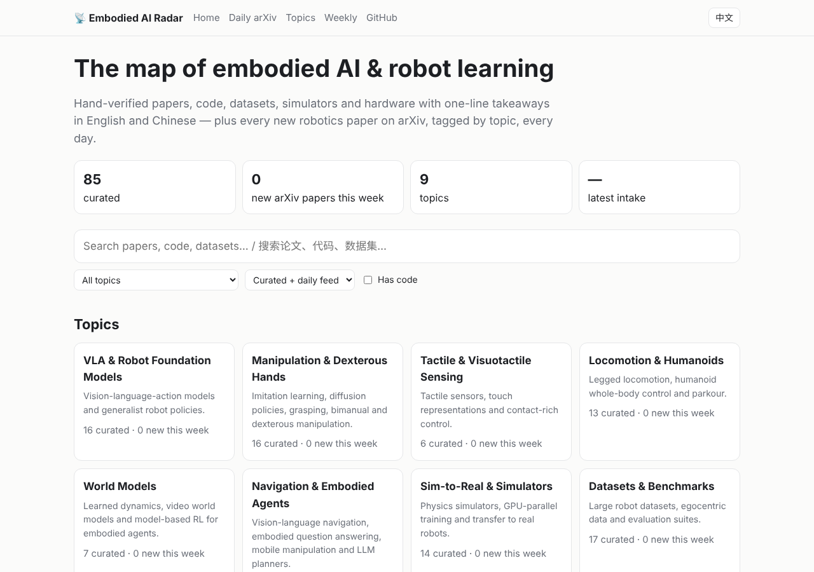

# 具身智能雷达 · Embodied AI Radar

**中英双语（[English](README.md) / 中文）、持续更新的具身智能与机器人学习全景图。**
人工核验的论文、代码、数据集、仿真器与硬件，配一句话要点；外加每天自动抓取并按主题标注的 arXiv 机器人新论文。

### 🌐 [打开网站 → hu-zlatan.github.io/embodied-ai-radar](https://hu-zlatan.github.io/embodied-ai-radar/?lang=zh)

**CoRL 2026（11 月 9–12 日，奥斯汀）：** [会议指南](https://hu-zlatan.github.io/embodied-ai-radar/venues/corl-2026-program.html?lang=zh)按日程与海报编号列出全部 687 篇录用论文，可筛选，附 arXiv 与代码链接，并收录 32 场研讨会。

**刚入门？** 跟着[入门路线](https://hu-zlatan.github.io/embodied-ai-radar/start.html?lang=zh)读：10 个阶段，从强化学习/模仿学习基础，到视觉运动策略、VLA、仿真、足式运动、世界模型，再到可以动手搭建的硬件，共 41 个精选条目，每条都有中英文要点。

## 特点

- **可信**：每个精选条目的 arXiv 编号都会与 arXiv 核对，所有链接每周由 CI 自动检查。
- **新鲜**：GitHub Action 每天抓取 cs.RO 新论文（以及 cs.CV / cs.LG / cs.AI / cs.CL 中的机器人相关论文）并按主题标注，自动出现在网站上。
- **好找**：快速静态网站，支持即时搜索（可直接输入中文关键词，如“人形 强化学习”“触觉”，自动匹配英文论文）与筛选（主题 · 机器人形态：机械臂、灵巧手、人形、足式、无人机… · 已录用会议（CoRL、NeurIPS、IROS 等） · 精选/每日 · 是否有代码），手机友好。已被会议接收的论文还按会议汇总成页面，例如 [CoRL 2026](https://hu-zlatan.github.io/embodied-ai-radar/venues/corl-2026.html?lang=zh)（[全部会议/期刊](https://hu-zlatan.github.io/embodied-ai-radar/venues/index.html?lang=zh)）；每种机器人形态也有独立页面和 Atom 订阅，例如 [人形](https://hu-zlatan.github.io/embodied-ai-radar/robots/humanoid.html?lang=zh) · [灵巧手](https://hu-zlatan.github.io/embodied-ai-radar/robots/hand.html?lang=zh) · [四足](https://hu-zlatan.github.io/embodied-ai-radar/robots/legged.html?lang=zh)；还可以按机构浏览，例如 [英伟达](https://hu-zlatan.github.io/embodied-ai-radar/labs/nvidia.html?lang=zh) · [清华大学](https://hu-zlatan.github.io/embodied-ai-radar/labs/tsinghua.html?lang=zh) · [上海人工智能实验室](https://hu-zlatan.github.io/embodied-ai-radar/labs/shanghai-ai-lab.html?lang=zh)（[全部机构](https://hu-zlatan.github.io/embodied-ai-radar/labs/index.html?lang=zh)）。
- **双语**：每个精选条目都有中英文一句话要点，网站支持 EN / 中文 切换。
- **好引用**：网站上每篇 arXiv 论文都可一键复制 BibTeX，[`curated.bib`](https://hu-zlatan.github.io/embodied-ai-radar/curated.bib) 打包了全部精选论文（由 arXiv 元数据生成）。每个精选条目都有独立的可分享页面，例如 [LEAP Hand](https://hu-zlatan.github.io/embodied-ai-radar/e/arxiv-2309.06440.html)。
- **不只是数量**：每篇论文显示其代码的 GitHub 星数；登上 [Hugging Face Daily Papers](https://huggingface.co/papers) 的论文还会显示社区点赞数（▲）。搜索可按二者排序，首页列出最近两周点赞最多的机器人论文。
- **代码追踪**：[精选索引的全部开源仓库](https://hu-zlatan.github.io/embodied-ai-radar/code.html)集中在一页：GitHub 星标、本周新增、最后更新与检测到的许可证，可按主题和许可证筛选。
- **可复用**：全部精选数据可下载为 [`curated.json`](https://hu-zlatan.github.io/embodied-ai-radar/curated.json) 或 [`curated.csv`](https://hu-zlatan.github.io/embodied-ai-radar/curated.csv)（可直接用 Excel 打开；CC BY 4.0），含主题、机器人类型、链接、中英文要点和 GitHub 星数，方便你做自己的工具。

| 内容 | 更新频率 |
|---|---|
| 每日 arXiv 论文（[网站](https://hu-zlatan.github.io/embodied-ai-radar/feed.html?lang=zh) · [Atom 订阅](https://hu-zlatan.github.io/embodied-ai-radar/feed.xml)；每个主题也有单独的 Atom 订阅，如 [VLA](https://hu-zlatan.github.io/embodied-ai-radar/topics/vla.xml)） | 每天自动 |
| 精选索引（见下方与网站）· 从每日论文中挑选的精选（[Atom 订阅](https://hu-zlatan.github.io/embodied-ai-radar/picks.xml)，每天几篇，中英双语） | 每周多次 |
| [每周精选](digest/) | 每周 |

## 精选索引

**推荐星级：** ⭐⭐⭐ 必读（每个主题最多一篇）· ⭐⭐ 强烈推荐 · ⭐ 推荐 · 无星 = 值得了解。每个主题先列出有星条目，再列最新精选，点击“查看全部”打开完整列表。由 [`data/curated/`](data/curated) 自动生成——请修改 YAML，而不是这些列表。

<!-- radar:start -->

[VLA 与机器人基础模型](#vla) · [操作与灵巧手](#manipulation) · [触觉与视触觉感知](#tactile) · [运动控制与人形机器人](#locomotion) · [世界模型](#world-models) · [导航与具身智能体](#navigation) · [感知、SLAM 与三维建图](#perception) · [规划、控制与安全](#control) · [机器人学习：强化学习与模仿学习](#learning) · [仿真与 Sim-to-Real](#sim) · [数据集与基准](#datasets) · [硬件与开源机器人](#hardware)

### VLA 与机器人基础模型

_视觉-语言-动作模型与通用机器人策略。_ [在网站上查看与最新论文 →](https://hu-zlatan.github.io/embodied-ai-radar/topics/vla.html)

- ⭐⭐⭐ **[π0: A Vision-Language-Action Flow Model for General Robot Control](https://arxiv.org/abs/2410.24164)** (2024) — VLM 主干加流匹配动作专家，跨多种机器人训练，能完成叠衣服等长时程灵巧任务。 · [代码](https://github.com/Physical-Intelligence/openpi)
- ⭐⭐ **[A Pragmatic VLA Foundation Model](https://arxiv.org/abs/2601.18692)** (2026) — LingBot-VLA：Apache-2.0 开源的基础模型，用九种双臂构型约 2 万小时真实数据训练，并在四个平台各 100 项任务上评测；代码、基座模型和评测数据一并开放。 · [代码](https://github.com/Robbyant/lingbot-vla) · [项目页](https://technology.robbyant.com/lingbot-vla)
- ⭐⭐ **[From Pixels to Actions - Towards Native Vision-Language-Action Policies](https://arxiv.org/abs/2611.06918)** (2026) — NEO-VLA 去掉独立视觉编码器：图像与语言在同一主干中共同演化，流匹配动作专家从多个深度读取特征。逐层探测显示，对动作关键的信号往往在最终视觉层之前达到峰值。 · [代码](https://github.com/EvolvingLMMs-Lab/NEO) · [项目页](https://weichenfan.github.io/NEO-VLA-Page/)
- ⭐⭐ **[Open-HumanWAM: An Open Recipe for Scaling Human and Robot Experience for Embodied Foundation Models](https://arxiv.org/abs/2611.06817)** (2026) — 开源 5 万小时带标注的第一视角视频语料及流程和权重。报告预训练时长与机器人成功率之间的对数线性规律，后训练后在 RoboTwin 2.0 Clean2Random 上达到 84.6%。 · [代码](https://github.com/DAGroup-PKU/HumanNet) · [项目页](https://dagroup-pku.github.io/open-humanscale/)
- ⭐⭐ **[RoboColosseum: Evaluating Physical Intelligence at Scale In-The-Wild](https://arxiv.org/abs/2611.02497)** (2026) — 在 124 个站点做盲测两两对比，横跨四种机器人评测 VLA 与前沿智能体。不同机器人的排名几乎不一致（Kendall W = 0.24），开箱排名也难以预测微调后的表现；G1 人形上没有策略完成任何任务。 · [代码](https://github.com/RoboColosseum/robocolosseum-client)
- ⭐⭐ **[π\*0.6: a VLA That Learns From Experience](https://arxiv.org/abs/2511.14759)** (2025) — RECAP 通过优势条件化，用演示、机器人自主运行数据和遥操作纠正对 VLA 做强化学习；论文报告在叠衣服、做意式咖啡等难任务上吞吐量提升一倍以上、失败率约减半。 · [项目页](https://pi.website/blog/pistar06)
- ⭐⭐ **[OpenVLA: An Open-Source Vision-Language-Action Model](https://arxiv.org/abs/2406.09246)** (2024) — 基于 Llama 2 与 DINOv2/SigLIP 的 7B 开源 VLA，是 VLA 研究与 LoRA 微调的事实开源基线。 · [代码](https://github.com/openvla/openvla)
- ⭐⭐ **[RT-2: Vision-Language-Action Models Transfer Web Knowledge to Robotic Control](https://arxiv.org/abs/2307.15818)** (2023) — 提出 "VLA" 概念：把网络规模的视觉语言模型联合微调为输出动作 token，把语义知识迁移到机器人控制。 · [项目页](https://robotics-transformer2.github.io/)
- ⭐ **[Being-H0.5: Scaling Human-Centric Robot Learning for Cross-Embodiment Generalization](https://arxiv.org/abs/2601.12993)** (2026) — CoRL 2026 Oral。跨形态 VLA，把人类交互轨迹当作通用“母语”，在 UniHand-2.0 上预训练：超过 3.5 万小时多模态数据，覆盖 30 种机器人形态。 · [代码](https://github.com/BeingBeyond/Being-H) · [项目页](https://research.beingbeyond.com/being-h05)
- ⭐ **[Demystifying When and Why VLAs Fail in Contact-Rich Tasks and How to Fix Them](https://arxiv.org/abs/2608.01402)** (2026) — CoRL 2026 Spotlight。分析 VLA 模型为何难以完成接触丰富的操作任务，并区分两类失败模式：难以输出接触时所需微小修正动作的精度失败，以及力失败。
- ⭐ **[EagleVLA: Towards Onboard Real-Time Robot Control via Foresight-Aligned Asynchronous Inference](https://arxiv.org/abs/2607.12659)** (2026) — EagleVLA：面向 Jetson Orin 等低功耗机载设备的 VLA 异步推理方法，针对异步执行带来的感知-执行错位与反应慢两个问题；CoRL 2026 Spotlight，曾用名 Jetson-PI。 · [代码](https://github.com/PKU-SEC-Lab/EagleVLA)
- ⭐ **[GigaBrain-0.5M\*: a VLA That Learns From World Model-Based Reinforcement Learning](https://arxiv.org/abs/2602.12099)** (2026) — 在 GigaBrain-0.5（预训练于 1 万多小时机器人操作数据）基础上，用以视频世界模型预测为条件的强化学习（RAMP）做后训练；论文报告在叠衣服、装箱和制作浓缩咖啡等难任务上比 RECAP 基线提升约 30%。 · [代码](https://github.com/open-gigaai/giga-brain-0) · [项目页](https://gigabrain05m.github.io)

**[查看全部 202 条 →](lists/vla.zh-CN.md)**

### 操作与灵巧手

_模仿学习、扩散策略、抓取、双臂与灵巧操作。_ [在网站上查看与最新论文 →](https://hu-zlatan.github.io/embodied-ai-radar/topics/manipulation.html)

- ⭐⭐⭐ **[Diffusion Policy: Visuomotor Policy Learning via Action Diffusion](https://arxiv.org/abs/2303.04137)** (2023) — 以去噪方式生成动作序列，比回归更能处理多模态演示，已成为模仿学习标准基线。 · [代码](https://github.com/real-stanford/diffusion_policy)
- ⭐⭐ **[AIRoA-0: Long-Horizon, Precise, Cross-Embodiment Manipulation from Handheld Data](https://arxiv.org/abs/2611.03815)** (2026) — 从 16,151 小时手持夹爪演示中学习，全程不采机器人数据；报告十项任务平均成功率 78%，其他 VLA 最好为 27%，并开放数据集、权重和后训练方案。 · [项目页](https://a-0.airoa.io)
- ⭐⭐ **[Generalizable Humanoid Manipulation with 3D Diffusion Policies](https://arxiv.org/abs/2410.10803)** (2024) — iDP3：上半身全身遥操作、带三维激光雷达的 25 自由度人形，加上改进的三维扩散策略，使技能不再局限于单一场景。 · [代码](https://github.com/YanjieZe/Improved-3D-Diffusion-Policy) · [项目页](https://humanoid-manipulation.github.io/)
- ⭐⭐ **[Universal Manipulation Interface: In-The-Wild Robot Teaching Without In-The-Wild Robots](https://arxiv.org/abs/2402.10329)** (2024) — 手持夹爪加 GoPro 可随处采集演示，训练出的策略可直接迁移到机械臂。 · [代码](https://github.com/real-stanford/universal_manipulation_interface)
- ⭐⭐ **[Learning Fine-Grained Bimanual Manipulation with Low-Cost Hardware](https://arxiv.org/abs/2304.13705)** (2023) — ALOHA + ACT：约 2 万美元的双臂遥操作平台，加上动作分块 Transformer，约 50 条演示即可学会精细任务。 · [代码](https://github.com/tonyzhaozh/act)
- ⭐ **[Constraint-Decomposed Impedance Control from Generative Policy for Articulated Object Manipulation](https://arxiv.org/abs/2610.16316)** (2026) — CoRL 2026 Spotlight。针对开门、拧螺栓、拉抽屉等铰接任务解决阻抗增益选择问题，这类任务中神经策略可能违反运动学约束。 · [代码](https://github.com/erickun0125/constraint-decomposed-impedance-control) · [项目页](https://erickun0125.github.io/constraint-decomposed-impedance/)
- ⭐ **[HexaShell: A Universal Harness for Robot Coding Agents in Simulation and the Real World](https://arxiv.org/abs/2610.23479)** (2026) — 编程智能体通过一条命令行驱动双臂机器人；每次失败后读取日志，编写或修复可复用的小工具程序。 · [代码](https://github.com/HexaFuture/HexaShell)
- ⭐ **[Learning Object-Centric Motion Priors from Human for Robotic Dexterous Manipulation](https://arxiv.org/abs/2611.05979)** (2026) — 从人手交互数据学习预测未来手物状态，并把预测的物体状态作为通用强化学习奖励，减少逐任务奖励设计；已部署到不同灵巧手（AAAI 口头报告）。
- ⭐ **[Long-Horizon Multi-Object Rearrangement via Distilled Tree Search over Continuous Actions](https://arxiv.org/abs/2610.25785)** (2026) — DISCO 在 GPU 并行物理仿真中用渐进展宽 MCTS 搜索长程重排计划，由学习的策略提出连续动作、价值函数打分，并周期性把搜索结果蒸馏回策略-价值模型；部署时无需仿真搜索。报告在仿真与真机重排任务上优于行为克隆、强化学习与搜索基线（CoRL 2026 Oral）。 · [代码](https://github.com/kallol-saha/DISCO) · [项目页](https://distilled-search.github.io)
- ⭐ **[Noise-Invariant Spatial Encoding for 3D Manipulation Policies under Depth Corruption](https://arxiv.org/abs/2610.24674)** (2026) — NISE 针对 3D 策略在真实深度噪声下的急剧失效，把位置不确定性带入注意力计算；在透明和反光物体上用普通 RGB-D 相机测试。
- ⭐ **[3D Diffusion Policy: Generalizable Visuomotor Policy Learning via Simple 3D Representations](https://arxiv.org/abs/2403.03954)** (2024) — 用紧凑点云编码作为扩散策略条件，比图像输入更省数据、对视角更鲁棒。 · [代码](https://github.com/YanjieZe/3D-Diffusion-Policy)
- ⭐ **[Mobile ALOHA: Learning Bimanual Mobile Manipulation with Low-Cost Whole-Body Teleoperation](https://arxiv.org/abs/2401.02117)** (2024) — 将 ALOHA 装上移动底盘；与静态 ALOHA 数据联合训练显著提升做饭、开柜等移动任务表现。 · [代码](https://github.com/MarkFzp/mobile-aloha)

**[查看全部 125 条 →](lists/manipulation.zh-CN.md)**

### 触觉与视触觉感知

_触觉传感器、触觉表征与接触丰富的控制。_ [在网站上查看与最新论文 →](https://hu-zlatan.github.io/embodied-ai-radar/topics/tactile.html)

- ⭐⭐⭐ **[DIGIT: A Novel Design for a Low-Cost Compact High-Resolution Tactile Sensor with Application to In-Hand Manipulation](https://arxiv.org/abs/2005.14679)** (2020) — 低成本、紧凑的 GelSight 式指尖传感器，让视触觉传感器得以普及。 · [代码](https://github.com/facebookresearch/digit-interface)
- ⭐ **[Visible Touch: Rendering Contact for Visuomotor Policies](https://arxiv.org/abs/2609.14156)** (2026) — CoRL 2026 Spotlight。通过渲染接触信息把触觉带入基于图像的视觉运动策略，针对现有方法需要专用触觉硬件、独立触觉编码器或非图像主干，难以与预训练 2D 视觉表征策略兼容的问题。 · [代码](https://github.com/qaz1678249/visibletouch) · [项目页](https://visibletouch.github.io/)
- **[Equivariant Visual-Tactile Diffusion Policy for Contact-Rich Manipulation](https://arxiv.org/abs/2610.03333)** (2026) — VISTA：等变视触觉扩散策略，把触觉融合进球面视觉 token 并随末端姿态旋转，提升富接触模仿学习的数据效率。 · [代码](https://github.com/Kenn3o3/Vista) · [项目页](https://vista-paper.github.io/)
- **[Modular Sensory Stream for Integrating Physical Feedback in Vision-Language-Action Models](https://arxiv.org/abs/2604.23272)** (2026) — 为预训练 VLA 增加独立的触觉、力和力矩信号流，通过跨模态联合注意力融合，配合分阶段训练和预测未来物理信号的辅助任务。真机实验验证。 · [项目页](https://jiminlx.github.io/MoSS)
- **[Tactile Curiosity Drives Robot Interaction](https://arxiv.org/abs/2609.40134)** (2026) — TacEx 让好奇心聚焦触觉：按感知模态分解模型不确定性，使探索去寻找接触而非空中乱动。采集的数据可离线训练抓放策略，也可用于 VLA 后训练。 · [项目页](https://go.klem.nz/tacex)
- **[ReflexArc: Bottom-Up Integration of Instantaneous Tactile Reflexes into Whole-Body Humanoid Control](https://arxiv.org/abs/2611.04424)** (2026) — 在学习型全身策略之下加入全身触觉反射，10 毫秒内直达电机；在 G1 上，与延迟 20 毫秒的相同反射相比，首次力峰值降低 34.1%。 · [项目页](https://minusmodulo.github.io/reflexarc-website/)
- **[AnyTouch: Learning Unified Static-Dynamic Representation across Multiple Visuo-tactile Sensors](https://arxiv.org/abs/2502.12191)** (2025) — 跨多种视触觉传感器学习统一的静态-动态表征，并贡献对齐的多传感器触觉数据集 TacQuad。 · [代码](https://github.com/GeWu-Lab/AnyTouch)
- **[FACTR: Force-Attending Curriculum Training for Contact-Rich Policy Learning](https://arxiv.org/abs/2502.17432)** (2025) — 低成本双边遥操作把机械臂受力反馈给操作者；训练时对视觉的破坏逐渐减弱，让策略学会关注力信息。
- **[LocoTouch: Learning Dynamic Quadrupedal Transport with Tactile Sensing](https://arxiv.org/abs/2505.23175)** (2025) — 在四足机器人背部铺设高密度触觉传感器，无需固定装置即可长距离运输未固定的圆柱物体。 · [代码](https://github.com/linchangyi1/LocoTouch)
- **[PP-Tac: Paper Picking Using Tactile Feedback in Dexterous Robotic Hands](https://arxiv.org/abs/2504.16649)** (2025) — 用带高分辨率全向触觉传感器的多指手抓取纸张类薄物体，同时解决状态估计与抓取规划。
- **[Tactile Robotics: An Outlook](https://arxiv.org/abs/2508.11261)** (2025) — 对触觉机器人的综合展望，涵盖压阻、压电、电容、磁性和光学等传感方式及领域走向。
- **[ManiWAV: Learning Robot Manipulation from In-the-Wild Audio-Visual Data](https://arxiv.org/abs/2406.19464)** (2024) — “手上长耳朵”：夹爪在野外人类演示时同步录制音频与视觉；当视觉信息不足时，接触声帮助策略完成接触密集操作。 · [代码](https://github.com/real-stanford/maniwav)

**[查看全部 53 条 →](lists/tactile.zh-CN.md)**

### 运动控制与人形机器人

_足式运动、人形全身控制与跑酷。_ [在网站上查看与最新论文 →](https://hu-zlatan.github.io/embodied-ai-radar/topics/locomotion.html)

- ⭐⭐⭐ **[Learning to Walk in Minutes Using Massively Parallel Deep Reinforcement Learning](https://arxiv.org/abs/2109.11978)** (2021) — 数千个 GPU 并行环境几分钟就能训练出四足行走策略；legged_gym 成为标准入门框架。 · [代码](https://github.com/leggedrobotics/legged_gym)
- ⭐⭐ **[Perceptive Humanoid Motion from Simulation](https://arxiv.org/abs/2611.06908)** (2026) — HALO 在上千个程序化生成的家庭场景中合成视觉-语言-动作数据来训练人形技能，数据量随算力增长。报告零微调迁移：六个未建图真实环境的 360 次试验成功率 91%。 · [代码](https://github.com/apple-aiml-research/ml-halo) · [项目页](https://apple-aiml-research.github.io/ml-halo/)
- ⭐⭐ **[BeyondMimic: From Motion Tracking to Versatile Humanoid Control via Guided Diffusion](https://arxiv.org/abs/2508.08241)** (2025) — 用同一套超参数的运动跟踪方案学会侧手翻、飞踢、冲刺等敏捷技能，再用带引导的潜空间扩散模型组合这些技能以完成摇杆遥控、避障等新目标，零样本迁移到真机。 · [代码](https://github.com/HybridRobotics/whole_body_tracking)
- ⭐⭐ **[SONIC: Supersizing Motion Tracking for Natural Humanoid Whole-Body Control](https://arxiv.org/abs/2511.07820)** (2025) — 检验规模定律在人形控制上的效果：扩大网络、数据和算力，得到通用动作跟踪基础模型，无需手工设计奖励。
- ⭐⭐ **[Real-World Humanoid Locomotion with Reinforcement Learning](https://arxiv.org/abs/2303.03381)** (2023) — 在仿真中训练的因果 Transformer 策略零样本驱动全尺寸人形机器人在户外行走。
- ⭐⭐ **[DeepMimic: Example-Guided Deep Reinforcement Learning of Physics-Based Character Skills](https://arxiv.org/abs/1804.02717)** (2018) — 证明强化学习能模仿包括空翻在内的大量动作片段并保持鲁棒，是后续人形动作模仿工作的基本范式。 · [代码](https://github.com/xbpeng/DeepMimic)
- ⭐ **[CMP: Robust Whole-Body Tracking for Loco-Manipulation via Competence Manifold Projection](https://arxiv.org/abs/2604.07457)** (2026) — CoRL 2026 Spotlight。提升足式移动操作臂全身末端跟踪对分布外输入（传感器噪声、不可行指令）的鲁棒性：用逐帧安全方案把无限时域安全约束转化为计算高效的单步流形约束。 · [项目页](https://shepherd1226.github.io/CMP)
- ⭐ **[SuperMimic: Scaling Humanoid Whole-Body Control with One Differentiable World Model](https://arxiv.org/abs/2610.28480)** (2026) — SuperMimic 不再蒸馏逐动作专家或用大算力硬训单一 RL 策略，而是把人形机器人动作跟踪策略与一个从仿真日志拟合的、共享动力学的可微世界模型联合训练（CoRL 2026 口头报告）。 · [项目页](https://supermimic.github.io)
- ⭐ **[ASAP: Aligning Simulation and Real-World Physics for Learning Agile Humanoid Whole-Body Skills](https://arxiv.org/abs/2502.01143)** (2025) — 从真实轨迹学习残差"增量动作"模型来修正仿真物理，实现敏捷的人形运动技能。 · [代码](https://github.com/LeCAR-Lab/ASAP)
- ⭐ **[KungfuBot: Physics-Based Humanoid Whole-Body Control for Learning Highly-Dynamic Skills](https://arxiv.org/abs/2506.12851)** (2025) — 通过多步动作处理和自适应动作跟踪，学习功夫、舞蹈等高动态技能。 · [代码](https://github.com/TeleHuman/PBHC) · [项目页](https://kungfubot.github.io)
- ⭐ **[OmniRetarget: Interaction-Preserving Data Generation for Humanoid Whole-Body Loco-Manipulation and Scene Interaction](https://arxiv.org/abs/2509.26633)** (2025) — 不仅保持身体姿态，还保留人与物体、人与场景交互的重定向方法，为人形移动操作生成物理上合理的数据。 · [代码](https://github.com/amazon-far/holosoma) · [项目页](https://omniretarget.github.io)
- ⭐ **[Retargeting Matters: General Motion Retargeting for Humanoid Motion Tracking](https://arxiv.org/abs/2510.02252)** (2025) — 说明脚滑等重定向瑕疵会损害跟踪策略，并提出通用重定向方法 GMR；其开源仓库在人形数据处理中使用广泛。 · [代码](https://github.com/YanjieZe/GMR) · [项目页](https://jaraujo98.github.io/retargeting_matters)

**[查看全部 124 条 →](lists/locomotion.zh-CN.md)**

### 世界模型

_学习的动力学模型、视频世界模型、世界动作模型（WAM）与基于模型的强化学习。_ [在网站上查看与最新论文 →](https://hu-zlatan.github.io/embodied-ai-radar/topics/world-models.html)

- ⭐⭐⭐ **[Mastering Diverse Domains through World Models](https://arxiv.org/abs/2301.04104)** (2023) — DreamerV3：一套超参数适用于 150 多个任务，包括从零开始在《我的世界》中挖到钻石。 · [代码](https://github.com/danijar/dreamerv3)
- ⭐⭐ **[Cosmos 3: Omnimodal World Models for Physical AI](https://arxiv.org/abs/2606.02800)** (2026) — 全模态世界模型家族，用一个 Mixture-of-Transformers 同时处理语言、图像、视频、音频和动作，把 VLM、视频生成、世界模拟器和世界动作模型并入同一框架。 · [代码](https://github.com/nvidia/cosmos) · [项目页](https://research.nvidia.com/labs/cosmos-lab/cosmos3/)
- ⭐⭐ **[DreamDojo: A Generalist Robot World Model from Large-Scale Human Videos](https://arxiv.org/abs/2602.06949)** (2026) — 在 4.4 万小时第一视角人类视频上预训练的基础世界模型，用连续潜动作代替缺失的动作标签，再用小规模机器人数据后训练。 · [代码](https://github.com/NVIDIA/DreamDojo) · [项目页](https://dreamdojo-world.github.io/)
- ⭐⭐ **[OpenWAM: An Open, Modular Exploration Towards Systematic World-Action Model Pretraining](https://arxiv.org/abs/2609.07398)** (2026) — 开放研究栈，把世界动作模型拆成可组合模块，并通过对照实验研究该从视频先验继承什么、世界学习与动作学习如何相互作用。 · [代码](https://github.com/OpenWAM-Official/OpenWAM) · [项目页](https://openwam-official.github.io/)
- ⭐⭐ **[RoboJEPA: Scaling Robotic Latent World Models](https://arxiv.org/abs/2610.10515)** (2026) — 跨 12 种机器人形态训练的 JEPA 世界模型；其想象误差随算力服从幂律，因此可以预测超出拟合规模时的模型质量。 · [代码](https://github.com/facebookresearch/robo_jepa) · [项目页](https://robojepa.github.io/)
- ⭐⭐ **[World Action Models: A Survey](https://arxiv.org/abs/2606.20781)** (2026) — 厘清 WAM 与世界模型、视频生成模型、VLA 的区别，并按生成内容（渲染、潜空间或不生成）和架构分类；结论是领域正走向少生成未来，只保留控制所需。 · [项目页](https://world-action-models.github.io/)
- ⭐ **[Causal World Modeling for Robot Control](https://arxiv.org/abs/2601.21998)** (2026) — LingBot-VA：同时学习帧预测和策略的自回归扩散框架，具有视频动作共享潜空间、闭环推演和异步推理。 · [代码](https://github.com/Robbyant/lingbot-va) · [项目页](https://technology.robbyant.com/lingbot-va)
- ⭐ **[Chunk-wise Model-based Policy Optimization](https://arxiv.org/abs/2610.14564)** (2026) — CoRL 2026 Spotlight。将分块世界模型用作训练期可微评估器的模型式强化学习，针对累积误差、推理延迟与 BPTT 不稳定问题。 · [代码](https://github.com/song-wx/CMPO) · [项目页](https://song-wx.github.io/cmpo.github.io/)
- ⭐ **[DreamX: Video Diffusion Model is a Universal Latent Action Learner](https://arxiv.org/abs/2611.05377)** (2026) — 复用预训练视频扩散模型提取紧凑潜动作（每帧 1,200 压到 4 个 token），作为人、机器人和不同环境之间的共享接口，并支持零示教动作迁移。 · [代码](https://github.com/cvlab-kaist/DreamX) · [项目页](https://cvlab-kaist.github.io/DreamX/)
- ⭐ **[Fast-WAM: Do World Action Models Need Test-time Future Imagination?](https://arxiv.org/abs/2603.16666)** (2026) — 追问世界动作模型在测试时是否需要想象未来：训练时保留视频联合训练，推理时跳过视频生成，以对照实验区分两者的作用。 · [代码](https://github.com/yuantianyuan01/FastWAM) · [项目页](https://yuantianyuan01.github.io/FastWAM/)
- ⭐ **[GigaWorld-Policy: An Efficient Action-Centered World--Action Model](https://arxiv.org/abs/2603.17240)** (2026) — 以动作为中心的世界动作模型：由观测预测动作，视频生成变为可选，动作精度不再依赖视频预测质量，推理开销也更低。 · [代码](https://github.com/open-gigaai/giga-world-policy) · [项目页](https://gigaai-research.github.io/GigaWorld-Policy/)
- ⭐ **[GreenWAM: A World Foundation Model for Robotics](https://arxiv.org/abs/2610.18774)** (2026) — 同一个世界模型兼作策略，用共享的关节坐标动作空间覆盖 20 类机器人；论文报告其在 WorldArena、RoboTwin 2.0、LIBERO-plus 上表现突出，并蒸馏出可实时运行的单步人形机器人策略。 · [代码](https://github.com/greenvla/GreenWAM) · [项目页](https://greenvla.github.io/GreenWAM)

**[查看全部 105 条 →](lists/world-models.zh-CN.md)**

### 导航与具身智能体

_视觉语言导航、具身问答、移动操作与大模型规划。_ [在网站上查看与最新论文 →](https://hu-zlatan.github.io/embodied-ai-radar/topics/navigation.html)

- ⭐⭐⭐ **[Do As I Can, Not As I Say: Grounding Language in Robotic Affordances](https://arxiv.org/abs/2204.01691)** (2022) — SayCan：大模型提出步骤，学习到的价值函数评估机器人当下实际能做什么。
- ⭐ **[Driving, Fast or Slow? Neuro-Symbolic Guidance for Motion Prediction in Multi-Modal Ground Mobility](https://arxiv.org/abs/2606.15251)** (2026) — TraCS 将由自然语言交规生成的可解释概率逻辑加到黑盒运动预测模型上；报告在 Argoverse 2 上稳定提升。Oral 论文。
- ⭐ **[ViNT: A Foundation Model for Visual Navigation](https://arxiv.org/abs/2306.14846)** (2023) — 在多种机器人的导航数据上训练的 Transformer 导航策略，经少量微调即可适配新的目标形式和新机器人。 · [代码](https://github.com/robodhruv/visualnav-transformer)
- ⭐ **[GNM: A General Navigation Model to Drive Any Robot](https://arxiv.org/abs/2210.03370)** (2022) — ViNT 的前作：在多种不同机器人汇集的数据上训练一个目标条件导航策略，可迁移到包括训练中未见过的新机器人。 · [代码](https://github.com/robodhruv/visualnav-transformer)
- ⭐ **[The Marathon 2: A Navigation System](https://arxiv.org/abs/2003.00368)** (2020) — ROS 2 标准导航栈 Nav2 的论文：用行为树编排规划器、控制器和恢复行为，并在真实机器人上长距离“马拉松”测试验证。 · [代码](https://github.com/ros-navigation/navigation2)
- **[Adaptive Risk-Certified Event-Triggered Replanning for Dynamic Navigation](https://arxiv.org/abs/2610.09302)** (2026) — 以校准后的障碍函数风险（MPC 预测轨迹上的 CVaR）作为预警信号，及时切换到更安全的规划模式。报告碰撞比仅用安全滤波器的基线减少 83.3%。 · [项目页](https://nail-uh.github.io/corl2026.github.io/)
- **[An Agentic Framework for Proactive Robots with Procedural Assistance Memory](https://arxiv.org/abs/2610.21211)** (2026) — 主动协助机器人：VLM 读取以有限状态机表示的用户日常流程记忆，决定何时提供何种帮助，再由 VLA 执行；记忆每天通过反思更新，无需重新训练。 · [项目页](https://davian-robotics.github.io/PAM/)
- **[CoFL-S: Spatially Queryable Sector Flow Fields for Local Language-Conditioned Navigation](https://arxiv.org/abs/2607.02222)** (2026) — 低层视觉语言导航动作头：在可见扇区上预测语言条件的流场并展开为连续轨迹；并提供连续时间的 Habitat 评测基准。 · [代码](https://github.com/ut-dragon-lab/CoFL)
- **[CoSMO: Conformal Semantic Mapping for Open-World Safe Robot Navigation](https://arxiv.org/abs/2610.18321)** (2026) — 用在线共形预测校准 VLM 语义地图，使不同类别物体获得有覆盖率保证的安全距离，且支持词表扩展。报告在 MP3D 上语义碰撞减少 61.6%，四足真机覆盖率 90.73%。 · [项目页](https://yangming911.github.io/cosmo-page/)
- **[CoopUQ: Robust Multi-Robot Social Navigation via Uncertainty-Aware Cooperative Forecasting](https://arxiv.org/abs/2610.26852)** (2026) — 多机器人社交导航：多机融合特征预测未来占据栅格及其不确定性，约束多智能体强化学习策略据此避开被预测占据或高度不确定的区域。Unity 仿真与真机验证。 · [项目页](https://coopuq.github.io/)
- **[CostNav: A Navigation Benchmark for Real-World Economic-Cost Evaluation of Physical AI Agents](https://arxiv.org/abs/2511.20216)** (2026) — 以经济账评估配送机器人导航：在 Isaac Sim 中结合公开财报与伤害数据计算成本、收入与盈亏平衡。报告七种基线方法目前都无法盈利。 · [代码](https://github.com/worv-ai/CostNav)
- **[G2-Nav: Grounded and Guarded Vision-Language Costmaps for Robot Social Navigation](https://arxiv.org/abs/2607.16956)** (2026) — 社交导航：让 VLM 生成代价地图而非直接决策，并校验上游跟踪，另加高频安全检查应对延迟；真机验证。 · [代码](https://github.com/centiLinda/G2-Nav)

**[查看全部 63 条 →](lists/navigation.zh-CN.md)**

### 感知、SLAM 与三维建图

_视觉/激光 SLAM 与里程计、三维重建、物体位姿、深度估计与开放词汇场景地图。_ [在网站上查看与最新论文 →](https://hu-zlatan.github.io/embodied-ai-radar/topics/perception.html)

- ⭐⭐⭐ **[ORB-SLAM3: An Accurate Open-Source Library for Visual, Visual-Inertial and Multi-Map SLAM](https://arxiv.org/abs/2007.11898)** (2020) — 最常用的特征点 SLAM 库：支持单目、双目与 RGB-D，可融合 IMU，并支持多地图重定位。 · [代码](https://github.com/UZ-SLAMLab/ORB_SLAM3)
- ⭐⭐ **[Segment Anything](https://arxiv.org/abs/2304.02643)** (2023) — SAM：可用点、框、掩码提示的分割模型，在 10 亿级掩码上训练；已成为机器人感知流程中获取物体掩码的常用基础组件。 · [代码](https://github.com/facebookresearch/segment-anything)
- ⭐ **[FoundationStereo: Zero-Shot Stereo Matching](https://arxiv.org/abs/2501.09898)** (2025) — 在大规模合成数据上训练的双目深度模型，报告称在真实场景上零样本精度很强；可直接作为双目相机机器人的深度来源。 · [代码](https://github.com/NVlabs/FoundationStereo)
- ⭐ **[SAM 3: Segment Anything with Concepts](https://arxiv.org/abs/2511.16719)** (2025) — 给定短名词短语或示例图像，即可在图像和视频中分割并跟踪某一概念的所有实例；数据引擎覆盖 400 万个概念标签，开放权重与 SA-Co 基准，可直接用作机器人开放词汇感知模块。 · [代码](https://github.com/facebookresearch/sam3)
- ⭐ **[VGGT: Visual Geometry Grounded Transformer](https://arxiv.org/abs/2503.11651)** (2025) — 单个前馈 Transformer 一次性为多视角图像预测相机参数、深度、点图与跟踪，约一秒完成。 · [代码](https://github.com/facebookresearch/vggt)
- ⭐ **[Depth Anything V2](https://arxiv.org/abs/2406.09414)** (2024) — 先只用深度精确的合成图像训练大教师模型，再给大量真实图像打伪标签来训练小模型；单目深度比 V1 更锐利、更鲁棒。 · [代码](https://github.com/DepthAnything/Depth-Anything-V2)
- ⭐ **[Depth Anything: Unleashing the Power of Large-Scale Unlabeled Data](https://arxiv.org/abs/2401.10891)** (2024) — 在数千万张伪标注图像上训练的单目深度模型，常被机器人系统直接拿来作为深度先验。 · [代码](https://github.com/LiheYoung/Depth-Anything)
- ⭐ **[FAST-LIVO2: Fast, Direct LiDAR-Inertial-Visual Odometry](https://arxiv.org/abs/2408.14035)** (2024) — FAST-LIVO2：在同一滤波器中融合激光雷达、相机与 IMU，两种传感器都采用直接法（无需提取特征）更新，并共用一张体素地图，图像块挂载在激光点上。 · [代码](https://github.com/hku-mars/FAST-LIVO2)
- ⭐ **[Grounding Image Matching in 3D with MASt3R](https://arxiv.org/abs/2406.09756)** (2024) — 在 DUSt3R 基础上加入稠密局部特征头，同一网络既输出三维点图又给出视角间精确的像素匹配，适用于免标定的三维重建与定位。 · [代码](https://github.com/naver/mast3r)
- ⭐ **[SAM 2: Segment Anything in Images and Videos](https://arxiv.org/abs/2408.00714)** (2024) — 用流式记忆把 SAM 扩展到视频：一次提示得到的掩码可在后续帧中持续跟踪，适合在操作过程中跟随目标物体。 · [代码](https://github.com/facebookresearch/sam2)
- ⭐ **[BundleSDF: Neural 6-DoF Tracking and 3D Reconstruction of Unknown Objects](https://arxiv.org/abs/2303.14158)** (2023) — 在 RGB-D 视频中跟踪从未见过物体的六自由度位姿，同时在线构建其神经三维模型，无需 CAD 模型；适用于操作新物体。 · [代码](https://github.com/NVlabs/BundleSDF)
- ⭐ **[CoTracker: It is Better to Track Together](https://arxiv.org/abs/2307.07635)** (2023) — 联合跟踪视频中大量点（而非逐点独立跟踪）的 Transformer，遮挡下依然稳健；常用于从人类或机器人视频中提取运动轨迹来学习策略。 · [代码](https://github.com/facebookresearch/co-tracker)

**[查看全部 43 条 →](lists/perception.zh-CN.md)**

### 规划、控制与安全

_运动规划、轨迹优化、模型预测控制、安全滤波器与安全的学习型控制。_ [在网站上查看与最新论文 →](https://hu-zlatan.github.io/embodied-ai-radar/topics/control.html)

- ⭐⭐⭐ **[cuRobo: Parallelized Collision-Free Minimum-Jerk Robot Motion Generation](https://arxiv.org/abs/2310.17274)** (2023) — 面向机械臂的 GPU 并行运动生成：同时运行大量轨迹优化，在毫秒级给出无碰撞且平滑的轨迹。 · [代码](https://github.com/NVlabs/curobo)
- ⭐ **[cuRoboV2: Dynamics-Aware Motion Generation with Depth-Fused Distance Fields for High-DoF Robots](https://arxiv.org/abs/2603.05493)** (2026) — cuRoboV2 新增考虑力矩限制的 B 样条轨迹优化和 GPU 原生 TSDF/ESDF 感知，面向高自由度机器人。 · [代码](https://github.com/NVlabs/curobo)
- ⭐ **[PyRoki: A Modular Toolkit for Robot Kinematic Optimization](https://arxiv.org/abs/2505.03728)** (2025) — PyRoki：模块化、跨平台的运动学优化工具包，可原生运行在 CPU、GPU 和 TPU 上。 · [代码](https://github.com/chungmin99/pyroki) · [项目页](https://pyroki-toolkit.github.io)
- ⭐ **[Planning with Diffusion for Flexible Behavior Synthesis](https://arxiv.org/abs/2205.09991)** (2022) — Diffuser：把规划视为对整条轨迹去噪，目标与奖励可以引导采样；扩散模型与控制结合的早期代表作。 · [代码](https://github.com/jannerm/diffuser)
- ⭐ **[Predictive Sampling: Real-time Behaviour Synthesis with MuJoCo](https://arxiv.org/abs/2212.00541)** (2022) — 推出 MuJoCo MPC（MJPC），可在 MuJoCo 中交互式地做实时预测控制，并表明简单的基于采样的规划器在接触丰富的行为上是很强的基线。 · [代码](https://github.com/google-deepmind/mujoco_mpc)
- ⭐ **[legged_control](https://github.com/qiayuanl/legged_control)** (2022) — 基于 OCS2 与 ros-control 的开源四足控制栈：非线性 MPC + 全身控制 + 状态估计，并支持 sim2real；基于模型的足式控制常用的起点。
- ⭐ **[Jerk-limited Real-time Trajectory Generation with Arbitrary Target States](https://arxiv.org/abs/2105.04830)** (2021) — Ruckig：开源 C++/Python 库，可实时生成到任意目标位置、速度和加速度的时间最优、限加加速度（jerk）轨迹；常被直接用于真实控制器上的机械臂平滑运动。 · [代码](https://github.com/pantor/ruckig)
- ⭐ **[OCS2: Optimal Control for Switched Systems](https://github.com/leggedrobotics/ocs2)** (2021) — 面向切换系统的非线性 MPC C++ 工具箱（SLQ、DDP、SQP），附足式机器人与移动操作臂示例；许多开源足式 MPC + 全身控制方案都基于它。
- ⭐ **[OSQP: An Operator Splitting Solver for Quadratic Programs](https://arxiv.org/abs/1711.08013)** (2020) — 基于 ADMM 的快速、鲁棒二次规划求解器，支持热启动与嵌入式 C 代码生成，广泛用于 MPC 与全身控制器。 · [代码](https://github.com/osqp/osqp)
- ⭐ **[Crocoddyl: An Efficient and Versatile Framework for Multi-Contact Optimal Control](https://arxiv.org/abs/1909.04947)** (2019) — 基于 DDP 的开源接触丰富轨迹优化求解器，广泛用于足式与人形机器人的运动生成和 MPC。 · [代码](https://github.com/loco-3d/crocoddyl)
- ⭐ **[MoveIt 2](https://moveit.ai/)** (2019) — ROS 2 的机械臂操作框架：提供运动规划、逆运动学、碰撞检测与实时伺服控制。 · [代码](https://github.com/moveit/moveit2)
- ⭐ **[Pinocchio](https://github.com/stack-of-tasks/pinocchio)** (2019) — 高性能 C++/Python 刚体动力学库，提供解析导数；是运动学、最优控制（如 Crocoddyl）以及足式/人形机器人控制栈的常用底座。

**[查看全部 36 条 →](lists/control.zh-CN.md)**

### 机器人学习：强化学习与模仿学习

_面向机器人的强化学习、模仿学习与策略后训练方法，不限机器人形态。_ [在网站上查看与最新论文 →](https://hu-zlatan.github.io/embodied-ai-radar/topics/learning.html)

- ⭐⭐⭐ **[Proximal Policy Optimization Algorithms](https://arxiv.org/abs/1707.06347)** (2017) — 采用截断目标的策略梯度方法，是大多数 GPU 并行仿真训练（运动控制、灵巧操作）背后的算法。
- ⭐⭐ **[Precise and Dexterous Robotic Manipulation via Human-in-the-Loop Reinforcement Learning](https://arxiv.org/abs/2410.21845)** (2024) — HIL-SERL：结合人类纠正的真机强化学习，报告称在精密装配与动态任务上经数小时训练即可接近满分成功率。 · [代码](https://github.com/rail-berkeley/hil-serl)
- ⭐ **[Control-Ready Uncertainty for Trajectory Diffusion](https://arxiv.org/abs/2610.12431)** (2026) — SCOPE 通过蒸馏得分函数曲率，让扩散轨迹模型无需蒙特卡洛采样即可给出校准的不确定性管道；在人群导航和 Franka 操作上测试。 · [项目页](https://zackaxue.github.io/SCOPE-project-page/)
- ⭐ **[Diffusion ReRoll: Revisable Denoising for Robotic Sequential Prediction](https://arxiv.org/abs/2607.19919)** (2026) — CoRL 2026 Spotlight。在扩散序列预测中选择性重新加噪，让时间跨度内的片段可以借助其余片段的上下文再次修正。 · [项目页](https://seonsoo-p1.github.io/DiffusionReRoll/)
- ⭐ **[FedGuide: Diffusion Prior Alignment and Value Baseline Guidance for Heterogeneous Federated Reinforcement Learning](https://arxiv.org/abs/2609.18964)** (2026) — 面向异构客户端的联邦强化学习：不再平均策略，而是用最优传输聚合扩散行为先验，并加入低方差的 DICE 价值基线。
- ⭐ **[Learning from Fleet Experience: Collective Experience Learning Across 96 Robots](https://arxiv.org/abs/2610.25736)** (2026) — 部署中的机器人共享执行经验：用失败片段在机群经验库中检索相似的成功片段来微调策略，无需新增示教或人工纠正。论文报告五个真机任务成功率 93–99%，96 台机器人把手机装盒任务从 79% 提升到 98%。 · [代码](https://github.com/RLinf/RLinf) · [项目页](https://cel-robot-learning.github.io)
- ⭐ **[Scaling in Games: Continued Pre-Training For Embodied Agents In Diverse Virtual Worlds](https://arxiv.org/abs/2610.28698)** (2026) — 针对游戏中的具身智能体做持续预训练的对照研究：120 组配置覆盖 0.8B–27B 模型、50–1600 小时数据和多世界混合；报告数据多样性有助于迁移到相近世界，对差异大的世界帮助有限。 · [代码](https://github.com/THUSI-Lab/GameScaling) · [项目页](https://gamescaling.github.io)
- ⭐ **[RLinf-VLA: A Unified and Efficient Framework for Reinforcement Learning of Vision-Language-Action Models](https://arxiv.org/abs/2510.06710)** (2025) — 面向 VLA 的开源强化学习训练框架（PPO/GRPO，支持 GPU 并行仿真器）；论文报告经 RL 后在 130 个 LIBERO 任务上成功率 98.11%、25 个 ManiSkill 任务上 97.66%，是 VLA+RL 研究常用的底座。 · [代码](https://github.com/RLinf/RLinf)
- ⭐ **[SimpleVLA-RL: Scaling VLA Training via Reinforcement Learning](https://arxiv.org/abs/2509.09674)** (2025) — 在 OpenVLA-OFT 上用 GRPO 与仅"成功/失败"二值奖励做在线强化学习，并加入若干促进探索的改动；论文报告 LIBERO 成功率 99.1%、RoboTwin 1.0 为 70.4%（SFT 基线 39.8%）。 · [代码](https://github.com/PRIME-RL/SimpleVLA-RL)
- ⭐ **[Decision Transformer: Reinforcement Learning via Sequence Modeling](https://arxiv.org/abs/2106.01345)** (2021) — 把强化学习改写成序列建模：GPT 式模型以期望回报为条件预测动作；是 Transformer 与控制结合的早期代表。 · [代码](https://github.com/kzl/decision-transformer)
- ⭐ **[What Matters in Learning from Offline Human Demonstrations for Robot Manipulation](https://arxiv.org/abs/2108.03298)** (2021) — robomimic：在人类采集的操作示教数据上系统比较模仿学习与离线强化学习（示教质量、观测选择、带历史的行为克隆），并开源框架与数据集。 · [代码](https://github.com/ARISE-Initiative/robomimic)
- ⭐ **[Addressing Function Approximation Error in Actor-Critic Methods](https://arxiv.org/abs/1802.09477)** (2018) — TD3：通过双 Critic、延迟策略更新和目标策略平滑解决 DDPG 的价值高估问题，至今仍是连续控制的常用基线。 · [代码](https://github.com/sfujim/TD3)

**[查看全部 78 条 →](lists/learning.zh-CN.md)**

### 仿真与 Sim-to-Real

_物理仿真器、GPU 并行训练与向真实机器人迁移。_ [在网站上查看与最新论文 →](https://hu-zlatan.github.io/embodied-ai-radar/topics/sim.html)

- ⭐⭐⭐ **[MuJoCo](https://mujoco.org/)** (2012) — 快速准确的接触物理仿真，机器人学习研究的默认仿真器，由 DeepMind 开源。 · [代码](https://github.com/google-deepmind/mujoco)
- ⭐⭐ **[When the Simulator Fails, Not the Policy: Auditing Contact Artifacts in Simulated Robot Benchmarks](https://arxiv.org/abs/2610.41857)** (2026) — 审计仿真基准：不少“策略失败”其实是物理引擎把物体弹飞。SimuGuard 为 LIBERO、RoboTwin、RoboCasa、RoboDojo 提供审计插件，把 RoboTwin 上的问题追溯到碰撞检测的一个常量；仅改动它，异常回合由 100 回合 12 次降到 0，五个容器任务成功率由 89% 升到 98%。 · [代码](https://github.com/ALEXander22568/simuguard)
- ⭐ **[Genie Sim 3.0 : A High-Fidelity Comprehensive Simulation Platform for Humanoid Robot](https://arxiv.org/abs/2601.02078)** (2026) — Genie Sim 3.0：面向操作的仿真平台，用 LLM 工具依自然语言生成场景，并提供基于 LLM 与 VLM 的自动化评测基准。 · [代码](https://github.com/AgibotTech/genie_sim)
- ⭐ **[Isaac Lab: A GPU-Accelerated Simulation Framework for Multi-Modal Robot Learning](https://arxiv.org/abs/2511.04831)** (2025) — Isaac Lab（Orbit 的后继）的正式论文：GPU 并行的物理、渲染与传感器仿真，内置机器人与任务，面向强化学习和模仿学习。 · [代码](https://github.com/isaac-sim/IsaacLab)
- ⭐ **[MuJoCo Playground](https://arxiv.org/abs/2502.08844)** (2025) — 基于 MJX 的 GPU 加速运动与操作环境，几分钟即可训练并迁移到真实机器人。 · [代码](https://github.com/google-deepmind/mujoco_playground)
- ⭐ **[Newton](https://github.com/newton-physics/newton)** (2025) — 基于 NVIDIA Warp 和 OpenUSD 的开源 GPU 物理引擎，支持多种求解器，面向接触丰富的机器人学习；由 Disney Research、Google DeepMind 和 NVIDIA 联合开发，由 Linux 基金会托管。
- ⭐ **[RoboTwin 2.0: A Scalable Data Generator and Benchmark with Strong Domain Randomization for Robust Bimanual Robotic Manipulation](https://arxiv.org/abs/2506.18088)** (2025) — 用多模态大模型自动生成并校验任务代码，在强域随机化（杂物、光照、背景、指令）下批量产出双臂演示数据的仿真管线，同时提供 50 个双臂任务的基准。 · [代码](https://github.com/RoboTwin-Platform/RoboTwin)
- ⭐ **[GRUtopia: Dream General Robots in a City at Scale](https://arxiv.org/abs/2407.10943)** (2024) — 面向多种机器人的交互式三维仿真社会；GRScenes 含 10 万标注场景、89 个类别，可组合成城市级环境。 · [代码](https://github.com/OpenRobotLab/GRUtopia)
- ⭐ **[Genesis](https://github.com/Genesis-Embodied-AI/Genesis)** (2024) — 开源、Python 原生的物理平台，覆盖刚体、软体、流体，支持高速 GPU 仿真。
- ⭐ **[Humanoid-Gym: Reinforcement Learning for Humanoid Robot with Zero-Shot Sim2Real Transfer](https://arxiv.org/abs/2404.05695)** (2024) — 基于 Isaac Gym 的人形机器人运动强化学习框架，先在 MuJoCo 中做 sim2sim 验证，再零样本部署到真实人形机器人，是人形 RL 的常用起点。 · [代码](https://github.com/roboterax/humanoid-gym)
- ⭐ **[ManiSkill3: GPU Parallelized Robotics Simulation and Rendering for Generalizable Embodied AI](https://arxiv.org/abs/2410.00425)** (2024) — GPU 并行仿真与渲染，内置大量操作任务，适合快速视觉强化学习与数据生成。 · [代码](https://github.com/haosulab/ManiSkill)
- ⭐ **[RoboCasa: Large-Scale Simulation of Everyday Tasks for Generalist Robots](https://arxiv.org/abs/2406.02523)** (2024) — 120 个厨房场景、2500 多个物体与 100 个任务，并附生成演示，用于训练通用策略。 · [代码](https://github.com/robocasa/robocasa)

**[查看全部 51 条 →](lists/sim.zh-CN.md)**

### 数据集与基准

_大规模机器人数据集、第一视角数据与评测基准。_ [在网站上查看与最新论文 →](https://hu-zlatan.github.io/embodied-ai-radar/topics/datasets.html)

- ⭐⭐⭐ **[Open X-Embodiment: Robotic Learning Datasets and RT-X Models](https://arxiv.org/abs/2310.08864)** (2023) — 30 多个实验室汇集 22 种机器人的 100 多万条轨迹；在其上训练的 RT-X 优于单机器人基线。 · [代码](https://github.com/google-deepmind/open_x_embodiment)
- ⭐⭐ **[LeRobot](https://github.com/huggingface/lerobot)** (2024) — PyTorch 机器人学习库，提供数据集、预训练策略（ACT、Diffusion、SmolVLA）与低成本机械臂驱动。
- ⭐⭐ **[LIBERO: Benchmarking Knowledge Transfer for Lifelong Robot Learning](https://arxiv.org/abs/2306.03310)** (2023) — 四个套件共 130 个语言条件任务，现已成为 VLA 论文最常用的仿真基准。 · [代码](https://github.com/Lifelong-Robot-Learning/LIBERO)
- ⭐ **[BEAKER: An Expert-Curated Benchmark for Embodied Brains in Self-Driving Chemical Laboratories](https://arxiv.org/abs/2611.06911)** (2026) — 1000 道专家整理的题目、11 种图像和视频任务，检验多模态大模型能否担任自动化化学实验室的“大脑”：可供性、轨迹、仪器搭建、安全与步骤推理。
- ⭐ **[WireCraft: A Simulation Benchmark for Industrial DLO Manipulation](https://arxiv.org/abs/2606.18097)** (2026) — CoRL 2026 Spotlight。面向工业装配中线缆等可变形线状物体（DLO）的仿真基准，针对现有基准绑定特定硬件、缺少模块化可定制任务资产等问题。
- ⭐ **[RoboVerse: Towards a Unified Platform, Dataset and Benchmark for Scalable and Generalizable Robot Learning](https://arxiv.org/abs/2504.18904)** (2025) — MetaSim 用统一接口封装多种仿真器（Isaac Sim/Gym、MuJoCo、Genesis、SAPIEN、PyBullet 等）；提供由公开基准迁移而来的大规模合成数据集，以及按泛化层级划分的统一模仿学习/强化学习基准。 · [代码](https://github.com/RoboVerseOrg/RoboVerse) · [项目页](https://roboverseorg.github.io/)
- ⭐ **[Evaluating Real-World Robot Manipulation Policies in Simulation](https://arxiv.org/abs/2405.05941)** (2024) — SimplerEnv：真实到仿真的评测环境，其得分与 RT-1/Octo 类策略的真机表现相关。 · [代码](https://github.com/simpler-env/SimplerEnv)
- ⭐ **[CALVIN: A Benchmark for Language-Conditioned Policy Learning for Long-Horizon Robot Manipulation Tasks](https://arxiv.org/abs/2112.03227)** (2021) — 连续执行五条语言指令，测试长时程、语言条件下的控制能力。 · [代码](https://github.com/mees/calvin)
- ⭐ **[Habitat: A Platform for Embodied AI Research](https://arxiv.org/abs/1904.01201)** (2019) — 极速的逼真 3D 仿真器与任务集，统一了具身导航研究的标准。 · [代码](https://github.com/facebookresearch/habitat-sim)
- ⭐ **[Meta-World: A Benchmark and Evaluation for Multi-Task and Meta Reinforcement Learning](https://arxiv.org/abs/1910.10897)** (2019) — 50 个 Sawyer 操作任务，用于多任务与元强化学习评测。 · [代码](https://github.com/Farama-Foundation/Metaworld)
- ⭐ **[RLBench: The Robot Learning Benchmark & Learning Environment](https://arxiv.org/abs/1909.12271)** (2019) — 100 个手工设计的操作任务并附演示，是 PerAct 等 3D 策略方法的常用基准。 · [代码](https://github.com/stepjam/RLBench)
- ⭐ **[ScanNet: Richly-annotated 3D Reconstructions of Indoor Scenes](https://arxiv.org/abs/1702.04405)** (2017) — 1500+ 个室内场景的 RGB-D 扫描，含三维重建、相机位姿与语义标注；具身感知所依赖的三维场景理解标准基准。 · [代码](https://github.com/ScanNet/ScanNet)

**[查看全部 80 条 →](lists/datasets.zh-CN.md)**

### 硬件与开源机器人

_可自行搭建的低成本机械臂、灵巧手、夹爪与数据采集设备。_ [在网站上查看与最新论文 →](https://hu-zlatan.github.io/embodied-ai-radar/topics/hardware.html)

- ⭐⭐⭐ **[LEAP Hand: Low-Cost, Efficient, and Anthropomorphic Hand for Robot Learning](https://arxiv.org/abs/2309.06440)** (2023) — 16 自由度灵巧手，用现成零件约 2000 美元即可搭建。 · [代码](https://github.com/leap-hand/LEAP_Hand_API) · [项目页](https://leaphand.com/)
- ⭐⭐ **[Pixel: A Co-Designed Full-Stack Robot System for Learning General-Purpose Mobile Manipulation](https://arxiv.org/abs/2611.03648)** (2026) — 把硬件、数据和学习放在一起设计：低成本轮式人形、柔顺夹爪，遥操作与免机器人的人类数据采集，统一的全身控制器，以及人类与机器人示范共用的策略学习流程。 · [项目页](https://pixel-robot.com/pixel)
- ⭐ **[Demonstrating Berkeley Humanoid Lite: An Open-source, Accessible, and Customizable 3D-printed Humanoid Robot](https://arxiv.org/abs/2504.17249)** (2025) — 开源人形机器人，采用 3D 打印的模块化减速器，在美国可用不到 5000 美元搭建；硬件设计、嵌入式代码与训练框架均已开源。 · [代码](https://github.com/HybridRobotics/Berkeley-Humanoid-Lite) · [项目页](https://lite.berkeley-humanoid.org)
- ⭐ **[OpenArm](https://github.com/enactic/openarm)** (2025) — 完全开源的 7 自由度人形机械臂，面向接触丰富的研究：CAD、电路、固件、ROS 2/MoveIt 2 以及 MuJoCo/Genesis 模型全部公开，支持主从力反馈遥操作与重力补偿（软件 Apache-2.0，硬件 CERN-OHL-S）。 · [项目页](https://openarm.dev)
- ⭐ **[ALOHA 2: An Enhanced Low-Cost Hardware for Bimanual Teleoperation](https://arxiv.org/abs/2405.02292)** (2024) — ALOHA 双臂平台的升级版（更强夹爪、重力补偿、更稳固的框架），开源硬件设计并提供 MuJoCo 仿真模型。 · [代码](https://github.com/tonyzhaozh/aloha) · [项目页](https://aloha-2.github.io/)
- ⭐ **[Open-TeleVision: Teleoperation with Immersive Active Visual Feedback](https://arxiv.org/abs/2407.01512)** (2024) — 带主动转向立体相机的 VR 遥操作系统，用于采集人形机器人操作数据。 · [代码](https://github.com/OpenTeleVision/TeleVision)
- ⭐ **[SO-ARM100 / SO-101](https://github.com/TheRobotStudio/SO-ARM100)** (2024) — 开源 3D 打印 6 自由度机械臂（主从臂），每只约 100–200 美元，是 LeRobot 的默认入门套件。
- ⭐ **[An Open Torque-Controlled Modular Robot Architecture for Legged Locomotion Research](https://arxiv.org/abs/1910.00093)** (2019) — 开源四足机器人 Solo 及其模块化力矩控制关节，采用现成件和 3D 打印件，便于各实验室复现动态腿式机器人。 · [代码](https://github.com/open-dynamic-robot-initiative/open_robot_actuator_hardware)
- **[PanoVine: Whole-Body Visuomotor Control for Soft Growing Vine Robot](https://arxiv.org/abs/2606.22923)** (2026) — 首个自主藤蔓（软体生长）机器人系统：沿机身分布的 19 个摄像头为从演示学到的端到端视觉运动策略提供反馈，能穿过分叉结构、爬坡并进入狭窄空间。 · [项目页](https://panovine-bot.github.io)
- **[MABEL: An Open Anthropomorphic Mobile Bimanual Platform for Teleoperation and Learning](https://arxiv.org/abs/2611.04083)** (2026) — 开源 56 自由度移动双臂机器人，含 7 自由度手臂和 17 自由度灵巧手，零件成本约 8100 美元，支持 Apple Vision Pro 遥操作，并演示了模仿学习全流程。 · [项目页](https://robotmabel.github.io/website/)
- **[RAIPAL: A Powerful and Agile Humanoid Arm for Human Tasks](https://arxiv.org/abs/2611.04334)** (2026) — 人形手臂，其力量、速度和耐力指标取自人类上肢测量数据；报告峰值负载 20 公斤（自重的 2.25 倍），末端速度 20.6 米每秒。
- **[Shape Your Body: Value Gradients for Multi-Embodiment Robot Design](https://arxiv.org/abs/2606.00702)** (2026) — 把冻结的多机器人价值函数作为可微代理模型来优化机器人设计，无需为每台机器人重跑协同设计 RL；可处理 1100 多个设计参数。

**[查看全部 42 条 →](lists/hardware.zh-CN.md)**

<!-- radar:end -->

## 相关列表与学习资源

领域内其他优秀的资源整理，以及推荐给新手的课程和文档。本雷达与它们互补：提供搜索、每日论文流和中英双语要点。

<!-- resources:start -->

**相关列表**

- [Embodied-AI-Guide](https://github.com/TianxingChen/Embodied-AI-Guide) `中文` — 中文具身智能入门指南，从基础知识一路讲到各研究方向。
- [Embodied_AI_Paper_List (HCPLab-SYSU)](https://github.com/HCPLab-SYSU/Embodied_AI_Paper_List) — 配合具身智能综述的论文列表，按感知、交互、智能体与 sim-to-real 组织。
- [awesome-humanoid-robot-learning](https://github.com/YanjieZe/awesome-humanoid-robot-learning) — 专注于人形机器人学习的论文列表。
- [Awesome-Robotics-Foundation-Models](https://github.com/robotics-survey/Awesome-Robotics-Foundation-Models) — 机器人基础模型相关论文，来自综述《Foundation Models in Robotics》。
- [awesome-embodied-vla-va-vln](https://github.com/jonyzhang2023/awesome-embodied-vla-va-vln) — 持续更新的视觉-语言-动作（VLA）与视觉-语言导航（VLN）论文列表。

**课程与教材**

- [Robotic Manipulation (MIT 6.4210, Russ Tedrake)](https://manipulation.csail.mit.edu/) — 免费在线教材与课程，涵盖操作中的感知、规划与控制，附 Drake 交互笔记本。
- [Underactuated Robotics (MIT, Russ Tedrake)](https://underactuated.mit.edu/) — 免费在线教材，讲解行走、飞行、游动机器人的非线性动力学、最优控制与轨迹优化。
- [CS 285 Deep Reinforcement Learning (UC Berkeley)](https://rail.eecs.berkeley.edu/deeprlcourse/) — Sergey Levine 的深度强化学习课程，讲座视频与课件公开。
- [蘑菇书 EasyRL (Datawhale)](https://github.com/datawhalechina/easy-rl) `中文` — 广受欢迎的开源中文强化学习教程（从 Q-learning 到 PPO、DDPG、TD3），附代码，可在线阅读。
- [动手学强化学习 (Hands-on RL)](https://github.com/boyu-ai/Hands-on-RL) `中文` — 以可运行的 Jupyter 笔记本组织的中文强化学习教材，在线版见 hrl.boyuai.com。

**工具文档**

- [LeRobot documentation](https://huggingface.co/docs/lerobot) — Hugging Face LeRobot 实操文档：采集数据、训练 ACT/扩散/VLA 策略并在低成本机械臂上运行。
- [Isaac Lab documentation](https://isaac-sim.github.io/IsaacLab/) — NVIDIA GPU 并行机器人学习框架的文档与教程。
- [MuJoCo documentation](https://mujoco.readthedocs.io/) — MuJoCo 物理引擎的参考与建模指南（MJX、MJCF、Python 绑定）。

**社区**

- [古月居 (GuYueHome)](https://www.guyuehome.com/) `中文` — 历史悠久的中文 ROS 与机器人社区，提供教程与论坛。

<!-- resources:end -->

## 参与贡献

发现缺少的好论文、代码库、数据集或机器人，或者发现错误？欢迎 [提交 issue](https://github.com/hu-zlatan/embodied-ai-radar/issues/new)，或提交一个在 `data/curated/<主题>.yaml` 中新增条目的 PR。详见 [CONTRIBUTING.md](CONTRIBUTING.md)。

## 项目如何运作

本仓库由 **AI 智能体**（Anthropic 的 Claude）按计划自动构建和维护，并由 [@hu-zlatan](https://github.com/hu-zlatan) 监督。智能体的工作章程见 [AUTOPILOT.md](AUTOPILOT.md)，笔记、决策和运行日志见 [`.autopilot/`](.autopilot)。数据绝不编造：未通过核验的条目会被修正或删除。

## 许可

代码：[MIT](LICENSE)。精选文本与数据：[CC BY 4.0](LICENSE-DATA.md)。arXiv 元数据：CC0，来自 [arXiv API](https://info.arxiv.org/help/api/index.html)。
